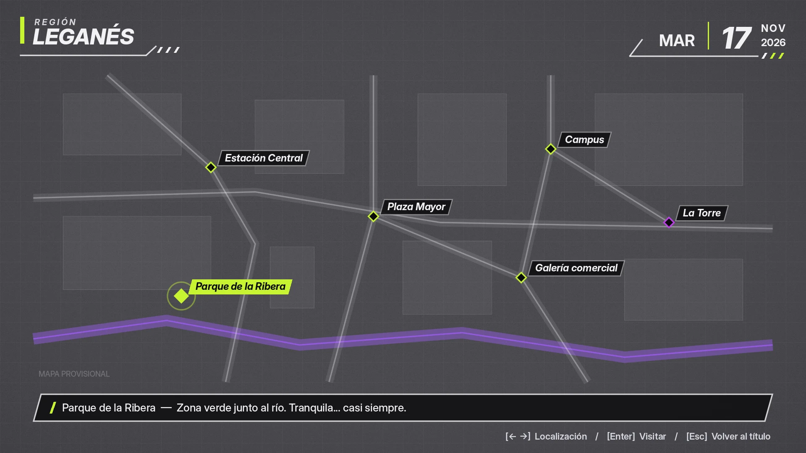

# Incursion From Beyond

JRPG híbrido con novela visual, ambientado en un mundo cotidiano y ligeramente futurista atravesado por entidades **biológicas, mecánicas, digitales, psíquicas y místicas**. Referencias: *Persona*, *Shin Megami Tensei*, *Digimon* y el cyberpunk.


## Requisitos

- [Godot 4.4](https://godotengine.org/download) o superior (versión estándar, sin .NET).

## Cómo ejecutarlo

1. Abre Godot → **Importar** → selecciona `project.godot`.
2. Pulsa **F5** (ejecutar proyecto). Arranca en el menú de inicio.

Desde terminal:

```bash
godot --path .
```

### Controles

| Acción | Teclado | Mando |
|---|---|---|
| Navegar | Flechas | Cruceta / stick |
| Confirmar | Enter / Espacio | A |
| Volver | Esc | B |
| Pantalla completa | F11 / Alt+Enter | — |

El ratón también funciona: pasar por encima selecciona y el clic confirma.

## Estado actual (v0.1.0)

- ✅ **Menú de inicio** con la estética de las referencias.
- ✅ **Pantalla de mapa** (provisional): cabeceras de región/fecha y un mapa de prueba con localizaciones navegables. Se sustituirá por el mapa real.
- ⬜ Interfaz de escenario (localización con personajes interactuables).
- ⬜ Interfaz de conversación (caja de diálogo).
- ⬜ Interfaz de combate.
- ⬜ Interfaz de estado de personaje.
- ⬜ Sistema de naturalezas y asimilación ([documento de diseño](docs/diseno/sistema_de_naturalezas_y_asimilacion_parte_1.md)).



## Estructura

```
project.godot
assets/
  fonts/inter/            Tipografía Inter Display (licencia OFL, ver LICENSE.txt)
src/
  autoload/               Singletons globales
    app.gd                  Tema por defecto, pantalla completa, versión
    game_state.gd           Estado de partida: región, fecha, dinero
    scene_router.gd         Cambio de pantalla con fundido
  ui/
    ui_style.gd             Paleta, tipografías y utilidades de dibujo (UIStyle)
    components/             Piezas reutilizables de interfaz
      slant_button.gd         Botón inclinado (lima al seleccionarse)
      region_header.gd        Cabecera «REGIÓN / LEGANÉS»
      date_header.gd          Cabecera «MAR | 17 NOV 2026»
      info_bar.gd             Barra de descripción inferior
    shaders/background.gdshader  Fondo con grano, viñeta y destellos
  screens/
    title/                  Menú de inicio
    map/                    Pantalla de mapa (provisional)
docs/
  diseno/                 Documentos de diseño de mecánicas
  ui/referencias/         Referencias visuales de cada interfaz
  capturas/               Capturas del estado actual
```

`docs/` tiene un `.gdignore` para que Godot no importe su contenido.

## Guía de estilo de interfaz

Las constantes están en `src/ui/ui_style.gd`:

| Uso | Color |
|---|---|
| Acento principal (selección, marcas) | Lima `#c6f432` |
| Acento secundario (sombras, río, rarezas) | Violeta `#9b5cf0` |
| Mazmorras / tensión | Magenta `#c23cf0` |
| Paneles | Negro `#0b0b0d` translúcido |
| Texto y líneas finas | Blanco `#f2f2f4` |

Rasgos recurrentes: texto en cursiva, formas en paralelogramo «/», marcas «///» y líneas blancas de 2 px con quiebro diagonal.

Los componentes son `@tool`, así que se ven tal cual en el editor de Godot.
