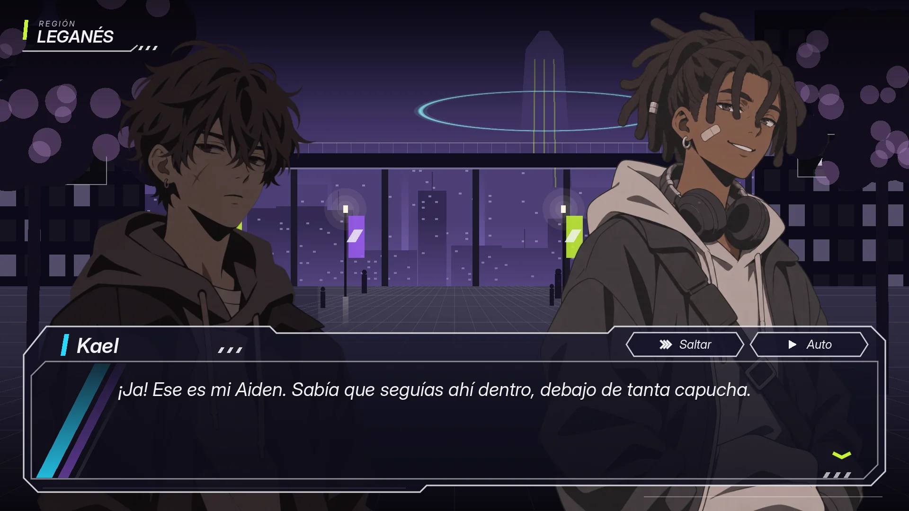
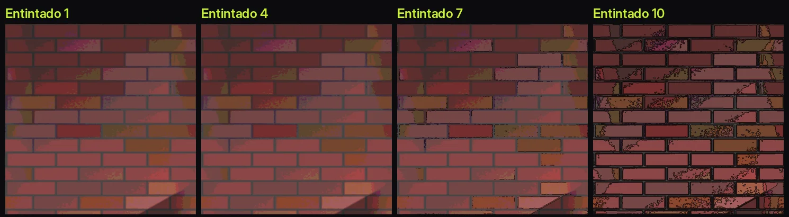

# Incursion From Beyond

JRPG híbrido con novela visual, ambientado en un mundo cotidiano y ligeramente futurista atravesado por entidades **biológicas, mecánicas, digitales, psíquicas y místicas**. Referencias: *Persona*, *Shin Megami Tensei*, *Digimon* y el cyberpunk.


## Versión de pruebas para móvil

- **Jugar en el navegador** (también en el móvil): https://pochico.github.io/incursion-from-beyond-jrpg/pruebas/
- **APK para Android**: no se sube al repositorio; se genera desde la rama `pruebas-movil` y se entrega aparte.
- Se genera desde la rama `pruebas-movil` (controles táctiles en la mazmorra, «atrás» de Android, orientación horizontal). Ver `CLAUDE.md`.

## Requisitos

- [Godot 4.7](https://godotengine.org/download) (versión estándar, sin .NET).
- Al clonar, activa los hooks de git del proyecto (una vez por copia):
  ```bash
  git config core.hooksPath .githooks
  ```
  Impiden subir cambios sin actualizar el contexto de `CLAUDE.md` (ver ese archivo).

## Cómo ejecutarlo

1. Abre Godot → **Importar** → selecciona `project.godot`.
2. Pulsa **F5** (ejecutar proyecto). Arranca en el menú de inicio.

Desde terminal:

```bash
godot --path .
```

### Controles

| Acción | Teclado | Mando |
|---|---|---|
| Navegar / elegir personaje | Flechas | Cruceta / stick |
| Confirmar / avanzar diálogo | Enter / Espacio | A |
| Abrir / cerrar mapa | **M** | Y |
| Cerrar menú o mapa / volver al título | Esc | B |
| Pantalla completa | F11 / Alt+Enter | — |

El ratón también funciona: pasar por encima selecciona y el clic confirma (también para avanzar el diálogo).

## Qué se puede jugar (v0.3.0)

1. **Menú de inicio** → «Nueva partida».
2. **Capítulo 1, día 1 (lunes 16 de noviembre)**. Es un día guiado: un aviso dice el objetivo, en el mapa solo se puede ir a ese destino (los demás responden «Ahora no») y no hay combates ni gente suelta por el mapa.
   - Despiertas con la alarma; Kenji te escribe al móvil. *Objetivo: ve al instituto*.
   - *Instituto*: Kenji pregunta qué tal el finde (si presumes de una cita, eliges con quién entre quienes te tienen afecto ≥ 15: Kenji se ofende si es Yuna, se parte si es su madre y no se lo cree con las demás; cuando llega la aludida al aula reacciona a su manera, y en Parquesur Kenji vuelve sobre ello); llega Yuna, su novia, le abraza por la espalda y se llaman «osito», «cariño», «cielo»; luego llegan Rika y Shiori y entra la profesora («Sentaos... toca aprender a derivar»). Kenji: «Qué coñazo». Shiori: «Espabila, que al final no llegas a selectividad». Fundido a negro, suena el timbre y quedan para ir a las camas elásticas. Mates II es la única asignatura en la que juntan las dos clases, por eso Kenji está en el aula.
   - *Objetivo: ve a Westfield Parquesur con el grupo*. Camas elásticas, fundido y despedida.
   - *Objetivo: vuelve a casa*. «Buah... Estoy hecho polvo.» Ren se duerme.
   - Las escenas están en `src/dialogue/capitulo1.dialogue` y los pasos en `src/data/chapter_db.gd`.
3. **Días 2 y 3 (martes y miércoles)**: juego libre con **planes que alguien propone** y que no son obligatorios. Cada mañana tiene su propio despertar en negro (la nota de Mamá en la nevera el martes, la lluvia y el sueño de la pantalla el miércoles; después de la incursión, el móvil lleno de mensajes; después de la reunión, el grupo renombrado «Cloacas FC»). Después llegan al móvil los mensajes de quien propone cada plan y unos avisos violetas con los **planes de hoy** («Has quedado» / «Sin contestar»). Si vas al sitio en esa franja, se juega la escena (y pasa la franja). Las invitaciones se **contestan** (ver «Invitaciones y plantones» más abajo): si dices que sí y no vas, te lo reprochan.
   - **Martes**: *Matemáticas II* (Instituto, mañana; Rika te pide los ejercicios, la profesora te saca a la pizarra), *Charla de leyendas urbanas* con Shiori (Egaleo, día; la leyenda de la Torre que crece de noche) y *Patinar en Bowls* con Kenji, Yuna y Akane (Bowls, tarde; Yuna te cuenta cuánto se preocupa Kenji por ti).
   - **Miércoles**: *examen sorpresa* (Instituto, mañana), *Vóley en Colinas* con Rika, Yuna y Kenji (día; Rika te pregunta cómo llevas lo de tu padre) y *Recreativas con Akane* (Westfield Parquesur, tarde; la máquina de baile con tu nombre a las 3:33).
   - **Jueves (día 4)**: hay que elegir. Por la mañana, **desayuno con Mamá** (libra; te propone cenar juntos con la tortilla de papá) y *Clase de Historia* (Rika por mensaje), donde Shiori y Kenji te proponen sus planes **en persona**. A mediodía coinciden *Hemeroteca con Shiori* (campus: la foto de La Torre de 1987 la hizo su abuelo, que tiene alzhéimer) y *Comer en Westlake con Yuna* (cuida de su hermano Haruto, quiere ser enfermera). Por la tarde, *Parque sin móvil con Kenji* (Ribera: su padre se fue a Alemania; el vinilo era suyo) y *Tarde de tiendas con Rika* (Parquesur: su hermana «la lista», el salón de uñas). Por la noche, *Concierto de Akane* (Las Ratas de Zarza, en el garito de la estación; vive con su abuela) y *Cena con Mamá* (cómo conoció a papá en Butarque, la gorra del Lega). Mamá también escribe a mediodía y por la tarde. Después de cada plan, quien te invitó tiene una charla nueva.
   - **Fin de semana (días 5, 6 y 7)**: nada es obligatorio. **Viernes**: *Clase del viernes* (Kenji te propone el partido del Lega y Rika la fiesta del sábado, en persona) y *pizza* por la tarde (en las Cloacas después de la reunión; antes, en Westlake). **Sábado**: desayuno con Mamá bailando un pasodoble; a mediodía coinciden *Hacer la tortilla con mamá* y *Cuidar de Haruto con Yuna* (Colinas); por la tarde, *Partido del Lega* en el bar de los padres de Yuna (Zarzaquemada; si dijiste que irías con la gorra de tu padre, la llevas); por la noche, *Fiesta en Westlake* con Rika y Akane. **Domingo**: churros con Mamá; *Visitar al abuelo de Shiori* en la residencia de la Ribera (por la mañana; Rika está allí haciendo las uñas a las señoras), *Cocido en casa de la abuela de Akane* (mediodía, encima de la estación) y *Serie y manta con mamá* (noche). Hay mensajes sueltos cada día (Mamá, Akane, Kenji, Rika).
   - **Ren propone planes** a quien quiera: en el menú del personaje, *Quedar* (actividad y cuándo), o en el chat del móvil, *Proponer plan*. Actividades (`ChapterDB.REN_ACTIVITIES`): cine, recreativas, Westlake, Bowls, vóley en Colinas y biblioteca, para lo que queda de hoy o mañana. Cada uno contesta según lo que siente por Ren, el sitio y su ánimo (Mamá, siempre que esté libre), o dice que ya ha quedado si tiene otro plan a esa hora. Se puede invitar a varios al mismo plan. Al ir al sitio a su hora se juega la quedada (`quedada_<actividad>` + lo de cada invitado); si no vas, cada invitado te escribe y baja la relación, como en los demás plantones.
   - **Invitaciones y plantones** (`Invites`, `src/systems/invites.gd`): unos planes llegan **por mensaje** (al empezar el día o una franja concreta) y otros te los proponen **en persona** (al hablar con quien invita, o dentro de otra escena); si no os veis a tiempo, te escriben. Puedes contestar *me apunto*, *esta vez paso* o *ya he quedado para…* (si has aceptado otro plan a la misma hora). No es excluyente: puedes decir que sí a dos planes a la vez, pero solo irás a uno. Si dices que sí y no vas, en cuanto pasa su franja baja la relación y te llega un reproche al móvil; si lo contestas (*perdona*, *estaba en…*, *se me olvidó*) se cierra ahí; si no, te lo dicen en persona la próxima vez que habléis.
   - **La primera incursión** llega a partir del día 8, a solas con alguien del grupo (ver punto 10). Después, Kenji convoca una **reunión en las Cloacas** (aviso «Reunión en las Cloacas»; cualquier día, menos de noche). Allí están Kenji, Yuna, Rika y Shiori (y Akane, si Ren ya tiene su número; las Cloacas son `friends_only`). Ren cuenta lo que pasó; quien estuvo con él lo confirma (`Story.incursion_with`) y los demás no se lo creen. Al final se calman: seguir con lo de siempre, apuntar en el grupo lo raro y no ir solos de noche. La historia pasa a la fase `reunion`.
   - **Incursiones 2 y 3** (sucesos `incursion_2` e `incursion_3` de `ChapterDB.BEATS`): al menos un día después de la reunión y de la anterior, al **llegar** a un sitio que no es seguro donde hay alguien del grupo (Kenji, Rika, Shiori o Yuna). Tiembla todo, aparecen criaturas (provisional: un Engendro; luego dos Imps) y Ren lucha con ese compañero, que lleva 2 habilidades al azar. Cada una deja una pista hacia **Colinas**: un rastro de barro con semillas de parque (`pista_barro`) y los móviles que apuntan todos a Colinas (`pista_colinas`); Shiori escribe después de cada una. Fases `incursion_2` e `incursion_3`.
   - **Conversaciones**: todos tienen charlas generales que no dependen del primer día, una propia del martes y otra del miércoles, una reacción si les dices que sí y los dejas plantados o si fuiste a su plan, y conversaciones nuevas tras la reunión (también por el móvil). Yuna ya tiene conversación completa (antes solo móvil) y está en Colinas con Kenji y Rika.
   - Planes en `ChapterDB.PLANS` (`src/data/chapter_db.gd`); escenas en `capitulo1.dialogue`; despertares en el cue `intro` de `general.dialogue`.
4. **Casa** (la habitación de Ren). La pantalla, la estantería y la cama tienen contorno: al pasar el ratón se resaltan y abren un menú con *Examinar*, que muestra lo que piensa Ren de cada cosa. Abajo a la derecha, el botón **(M) Mapa**. Desde el jueves, **Mamá** está en casa por la mañana y por la noche (`cast_when` en `LocationDB`); con ella solo se puede *Hablar*.
5. **Mapa**: elige cualquier ubicación (con clic en el rombo o en su nombre) y viajas a ella. Cada una tiene su propio fondo.
6. **Escenario**: cada ubicación tiene su gente, con una silueta brillante de su color. Al pasar el ratón o seleccionarlos con flechas se resaltan y muestran su nombre.
   - **Gente que Ren no conoce** (`Acquaintance`; quien tiene `stranger_name` en `CharacterDB`, hoy Akane): sale con un nombre genérico («Tía punki») y su menú solo tiene *Saludar* (cue `<id>_presentacion`). Después ya sale su nombre y el menú tiene *Hablar* (charlas cortas, `<id>_charla`) y *Pedir el número* (`<id>_amistad`): desde ahí está en Contactos, Mensajes y Relaciones, escribe y propone planes. Hasta entonces no aparece en el móvil, no escribe y sus planes no salen. También se la presentan en escenas (Kenji en Bowls, Rika en la fiesta: `Story.introduce`). Sin cues propios se usan `conocido_*` de `general.dialogue`.
   - *Plaza Mayor* (en el mapa, «Colinas»): Kenji, Rika y Yuna. *Campus* («Egaleo»): Shiori. *Westfield Parquesur*: Akane.
   - *Estación de Zarzaquemada*, *Parque de la Ribera* y *La Torre* están vacías: al llegar, temblor y combate contra un enemigo al azar.
   - *Cloacas*: un canal subterráneo con una cascada en escalones. Es un lugar seguro (sin combate). Desde la primera incursión es donde se junta el grupo: Kenji, Shiori, Rika, Akane y Yuna (hasta 5 a la vez), cada uno **integrado en el fondo** con su pose y en su sitio (`cast_phase` en `LocationDB`). Resaltan solo al pasar el ratón; con clic se abre el menú (Hablar, Luchar, Ligar) y la conversación empieza solo al elegir.
   - *Westlake*: la terraza de tarima junto al lago del Parquesur (al lado de Westfield Parquesur en el mapa). Lugar seguro. Pueden estar Kenji, Shiori, Rika, Akane y Yuna (3 a la vez, se cambia en el editor del mapa), cada uno **integrado en el fondo** con su pose: Akane y Kenji sentados en la grada, Shiori de pie con sus libros, Rika apoyada en la barandilla y Yuna mirando el agua. Las poses salen de una ilustración de grupo: donde Akane tapa a Kenji, a Kenji le falta ese trozo (con los dos presentes no se nota).
   - *Instituto*: el aula de Ren, Rika y Shiori. Fuera de horario está vacía, pero es un lugar seguro (no hay combate).
7. **Menú de interacción**: *Hablar*, *Luchar*, *Ligar* o *Cita*.
   - *Hablar*: conversación larga con opciones de diálogo. Cada opción tiene un estilo (franco, bromista, reservado...) y los presentes reaccionan por detrás según su personalidad.
   - **Gestos**: el retrato del interlocutor cambia de cara (enfado, sorpresa, incomodidad) con un fundido breve, un saltito si se sorprende y una sacudida si se enfada. Manda, por orden: una etiqueta en la línea del diálogo (`Rika: ¿Desde cuándo? [#cara=sorpresa]`; `[#cara=normal]` la quita); su reacción a la última opción de Ren (si le sienta mal o le asusta, se le nota durante sus dos líneas siguientes); y su ánimo, si es intenso (irritado → enfado; ansioso o triste → incomodidad). Si un personaje no tiene ese gesto, sale con la cara normal.
   - *Luchar*: el personaje acepta el reto → fundido → **combate** → comentario de la pelea (distinto si ganas o pierdes).
   - *Ligar*: respuestas cortas y distintas para cada personaje.
   - *Cita*: eliges sitio (Westfield Parquesur, Bowls, Colinas, Egaleo o Cloacas). Acepta o no según lo que siente por Ren, su ánimo y lo que le gusta el sitio. Si dice que no, dice por qué: no le apetece hoy, mejor otro sitio, tiene pareja o no siente lo mismo. Si acepta, fundido al sitio, cita con opciones y pasa la franja. Al final de una cita que va bien te pregunta «¿qué somos?» y podéis empezar a salir.
   - **Mentiras**: algunas respuestas de Ren son mentiras («me puse malo», «estuve en casa»). Quien está delante y sabe la verdad te cubre si te aprecia más a ti que a quien engañas, o te delata si no. Lo que cuela queda como secreto: por la mañana, quien lo sabe y prefiere al engañado se lo cuenta, y luego te lo echa en cara. Si quedas con alguien a espaldas de tu pareja, te pregunta dónde estuviste (confiesas, mientes o te escabulles). Lógica en `src/systems/lies.gd`.
   - **Sucesos de relación**: parejas nuevas, rupturas y enfados graves (un golpe fuerte a la relación de una vez) quedan en el registro de acontecimientos con quién lo sabe; cada mañana se lo cuentan los amigos. Los enfados con Ren duran hasta hacer las paces o una semana. Aún no hay diálogos que reaccionen. Lógica en `src/systems/relation_events.gd`.
   - **Parejas**: Kenji y Yuna empiezan juntos. Si Yuna (o Kenji) siente bastante por Ren, acepta la cita y deja a su pareja, con consecuencias para el grupo. Con pareja, cada mañana te escribe; si pasas días sin verla, no vas a sus planes o quedas con otra persona, te puede dejar (te lo dice al despertar). También puedes cortar tú desde la conversación. Lógica en `src/systems/romance.gd`; diseño en `personajes_y_relaciones.md` («Citas y parejas»).
8. **Conversación**: el protagonista (Ren) siempre a la izquierda, el interlocutor a la derecha, sobre el mismo fondo de la ubicación. Botones *Saltar* y *Auto*.
9. **Combate** (por turnos, prototipo; valores pendientes de prueba de combate):
   - **Nivel 1 para todos**: Ren, compañeros y criaturas empiezan en el nivel 1, con atributos de referencia (~10). PV = 100 + 10·nivel + 5·RES (Ren y compañeros: 165) y PM = 35 + 3·nivel + 2·máx(INT, VOL) (58). Las criaturas tienen un **tier de poder** (`CharacterDB.ENEMY_TIERS`, valores provisionales): tier 1, PV normales y −10 % de daño; tier 2 (Oni y Tiranosaurio), ×1,7 PV y +1 a todos los atributos. Sus habilidades son de su tier o menos (las básicas de cada naturaleza cuentan como tier 1). Un **jefe** (`boss` en el mapa) lleva además ×1,25 PV.
   - **Combates de hasta 3 rivales** (`Battle.FOES`: `enemy`, `enemy2`, `enemy3`): salen en fila, más pequeños, cada uno con su placa (la del jefe dice «JEFE»). Al atacar, usar una habilidad de un objetivo o una granada, se elige contra quién con el **marco lima** (esquinas y etiqueta «Acción · Rival», como lo de delante en la mazmorra): empieza en el de más a la izquierda; ←/→ o un clic/toque en otro lo cambia, y Enter, volver a pulsar la opción o tocar al marcado confirma (Esc vuelve). El comando y la opción elegidos se quedan marcados. Cada rival actúa en su turno; la guardia dura hasta que acaban todos. Al caer uno, se apaga y los demás siguen; se gana cuando caen todos, y la EXP y el dinero se suman. En grupo, cada criatura (menos el jefe) tiene menos PV y pega menos (`CharacterDB.GROUP_SCALE`: ×0,85 con dos, ×0,7 con tres). *Analizar* revela a todos.
   - **Atacar** → ataque básico gratis: 0,75 × daño base con FUE contra RES (~31–35 a nivel 1).
   - **Habilidad** → las del personaje, con su coste en PM y su recarga, que crecen con el nivel según fórmula (sin tablas ni interpolación). Ren: *Puñete*, *Impulso orgánico*, *Regeneración celular* y *Resiliencia*. Catálogo de 42: las 32 por tipo (PSY, ARQ, BIO, CYBER, MECH, con tier 1–5) de `docs/diseno/habilidades_tiers.md` y las 10 intrínsecas de `habilidades_1.md`.
   - **Efectos**: daño en área, daño y curación por turnos, potenciadores y penalizaciones de daño (máximo ×2,5 combinado), reducciones (máximo 70 %, la guardia incluida), precisión y esquiva (máximo 85 %), perder el turno (aturdido, interrumpido, desactivado, excorporado), inmunidad (Proyección astral, Excorporar), Empatía (reparte el daño a medias), Dominio por bando, acción al azar (Adivinación), limpiar estados, recuperar PM y costes en PV (nunca matan: dejan 1 PV).
   - **Compatibilidad**: cada personaje tiene etiquetas (tejido, materia, metal, electrónica, datos, mente, vista, oído; por defecto, las de su naturaleza). El veneno no afecta a máquinas, *Inutilizar dispositivo* solo a electrónica, *Deslumbrar* necesita vista... Si no se puede usar, la opción sale apagada con el motivo.
   - **Objeto** → lo que llevas que sirve en combate: *Pochicola* (empiezas con 3; restaura 80 PV), *Batido Chocopolved* (30 PM) y *Granada táctica* (120 de daño al rival, sin elegir a quién; la guardia del rival la reduce). Los que curan preguntan a quién del grupo se le dan. El rival lleva una Pochicola y la usa cuando va bajo de vida.
   - **Defender** → reduce a la mitad el daño hasta tu siguiente turno.
   - **Analizar** → revela nivel, PV, ataque y técnicas del rival; no gasta el turno.
   - **Huir** → te rindes (cuenta como derrota).
   - **Animación por tipo de golpe** (`AttackFx`): ataque básico del grupo, tajo doble en aspa; *Biológico*, tres zarpazos y salpicadura; *Mecánico*, destello, ondas expansivas y chispas (sacude más); *Digital*, fallo de imagen con franjas, bloques y retícula; *Psíquico*, anillos ondulados que se cierran y estallan; *ARQ*, un sello con estrella que se dibuja y una columna de luz. Sale sobre el rival o sobre la ficha de quien recibe el golpe; el ataque básico de una criatura usa su naturaleza.
   - **Estados a la vista** (`StatusBadges`): bajo la placa del rival, pastillas con cada estado y sus turnos, del color de su origen (lima biológico, cian tecnológico, rosa psíquico, violeta arquetípico; rellenas si perjudican, con borde si ayudan). Si tiene uno perjudicial, la barra de PV late con ese color. En las fichas del grupo, rombos sobre el retrato y el retrato teñido y latiendo si hay un estado perjudicial, además de la pastilla de arriba.
   - La *Tensión* es solo visual por ahora. Datos en `CharacterDB.combat`, fórmulas y catálogo en `SkillDB`, lógica en `Battle`.
   - **Ficha de estado**: en «Estado» solo salen los estados que tienes (violeta, negativos; lima, positivos) o «Normal». Al pasar el ratón por uno aparece un tooltip con qué hace, los PV que quita o da por turno y los turnos que le quedan. Los textos están en `SkillDB.STATUSES`.
   - **Recompensa**: al ganar, recibes ¥ = nivel de la criatura × 120, con un +15 % por cada nivel que la criatura te saque y un −15 % por cada nivel que tú le saques (mínimo, el 10 %). Ejemplos: misma altura, nivel 15: ¥ 1.800; criatura 10 niveles por encima: ¥ 4.500; 10 niveles por debajo: ¥ 180. Se ve bajo «VICTORIA» y se suma a la cabecera. Constantes en `Battle.REWARD_*`.
10. **Primera incursión** (suceso `incursion_1` de `ChapterDB.BEATS`, ver `StoryBeats`): **desde el día 8**, la primera vez que Ren está **a solas con uno de su grupo** (Kenji, Rika, Shiori o Yuna): al hablar con él en un sitio donde no hay nadie más, o al terminar un plan con él solo. Si el día 10 aún no ha pasado, Kenji le cita a solas en Bowls por la tarde para escuchar su base nueva (plan `kenji_a_solas`), y al terminar salta. La conversación se corta con un temblor y aparece una criatura, elegida al azar en cada partida:
   - **Tiranosaurio mutante** (Digital, tier 2): *Corrupción de datos*, *Deslumbrar* y *Depuración*.
   - **Oni** (ARQ, tier 2): *Manifestación arcana*, *Marca funesta*, *Maldecir* y *Bendecir* (a otra criatura del grupo).
11. **Enemigos aleatorios** (ubicaciones vacías): los dos anteriores y además
   - **Engendro** (Psíquico, tier 1, una manifestación de la rabia): *Choque mental* y *Disonancia*. Tiene cuerpo pero no tejido vivo: no se envenena ni sangra.
   - **Turbina** (Mecánico, tier 1): *Impacto cinético* y *Chispazo*.
   - **Crawler** (Mecánico, tier 1): torreta cuadrúpeda. *Proyección de fragmentos* y *Chispazo*.
   - **Imp** (ARQ, tier 1): *Marca funesta*.
   - **Querubín** (ARQ, tier 1): *Manifestación arcana*.
   - **Troyano** (Digital, tier 1): *Corrupción de datos* y *Depuración*.
   - La naturaleza que antes se llamaba «Místico» se muestra ahora como **ARQ** (arquetípica: mitos, símbolos y leyendas encarnados). En el código sigue siendo `mystic`.
12. **Combate de la primera incursión**: Ren y quien estaba con él, **solo con lo básico**: *Atacar*, *Defender* y *Huir* (*Habilidad*, *Objeto* y *Analizar* salen apagados; regla `basic_only` de `CombatView.setup`). Si ganan, **los dos suben un nivel** (aviso «Ren y Kenji suben al nivel 2»); si pierden, la historia sigue igual, sin la subida. Cada miembro del grupo elige su acción en su turno (la ficha activa se resalta) y después actúa el rival. Fuera de la incursión, el primer combate contra una criatura sigue dando al compañero 2 habilidades al azar.

En combate, los comandos (*Atacar*, *Habilidad*, *Objeto*...) se eligen con clic o con el teclado; pasar el ratón por encima solo cambia la opción resaltada del submenú.

**Franjas del día**: el día tiene cuatro franjas (*mañana*, *día*, *tarde* y *noche*), que se ven en la cabecera de la fecha (`GameState.TIME_SLOTS`). Las actividades pasan a la siguiente: la clase (mañana → día) y las camas elásticas (día → tarde), marcadas con `advance_time` en `ChapterDB`. La **cama** de casa tiene, además de Examinar:
- **Siesta**: pasa una franja (de noche, equivale a dormir);
- **Dormir**: hasta la mañana siguiente, desde cualquier franja.
Durante un objetivo del guion la cama responde «Ahora no». Al pasar al día siguiente sale una animación (`DayTransition`): un reloj corre hasta las 7:00 y la hoja del calendario cambia de número y de día de la semana.

**Móvil («Terminal»)**: botón *T Terminal* abajo a la derecha, junto a *Mapa* (o tecla T). Solo se abre explorando, nunca en combate ni en conversación. Oscurece la escena y muestra la hora, el clima y las apps sobre el fondo de pantalla (`assets/phone/fondo.png`, con un velo oscuro para que se lea la interfaz). Se navega con ratón o flechas + Enter; *Esc* o el botón «<» vuelven atrás y *T* o un clic fuera lo cierran.
   - *Contactos*: Kenji, Rika, Shiori, Yuna y Mamá, y Akane cuando Ren tiene su número (ver «Gente que Ren no conoce»). Al elegir uno se abre el chat y puedes **saludar**: Ren escribe y el contacto responde tras un «escribiendo...». La respuesta sale del selector de diálogos (momento `movil` en el `.dialogue` de cada uno) y cambia según su ánimo, la relación, si ya le has escrito hoy y si pasó la incursión. Si el contacto **espera respuesta** (una invitación o un reproche por un plantón), en vez de *Saludar* salen botones con las respuestas; lo que os decís sale de `<id>_movil_plan` / `<id>_movil_plantado` en su `.dialogue`. Si no espera nada, salen *Saludar* y *Proponer plan*.
   - *Mensajes*: solo aparecen las conversaciones que ya existen, de la más reciente a la más antigua. Se guardan en la partida.
   - *Relaciones*: cómo está cada personaje con Ren: el tramo (Hostil, Fría, Neutral, Cercana o Íntima), su ánimo de hoy, barras de afecto, confianza y respeto, y además atracción, miedo, asco o resentimiento si destacan. Salen Kenji, Rika, Shiori, Yuna, Mamá, la madre de Kenji y Akane cuando ya es amiga. **Depuración** (ejecutando desde el editor o en una exportación con depuración): al tocar a alguien se abre un panel con barras deslizables (ratón o dedo) para cambiar en directo lo que siente por Ren u otro personaje («Hacia»), su ánimo y la intensidad; al cerrar se guarda la partida.
   - *Inventario*: los objetos que llevas, con cantidad y descripción.
   - *Equipo*: arma, accesorio y módulo de Ren y sus compañeros (de momento solo se muestran; no afectan al combate).
   - *Misiones*, *Ajustes* y *Criaturas* aún no tienen contenido (referencias en `docs/ui/referencias/07_*`–`11_*`).

**Pantalla de estado**: en combate, clic en una ficha del grupo (o *Tab*, para quien está eligiendo) abre la pantalla del personaje. Muestra la ilustración en grises, el nivel, la naturaleza, los PV y PM, los atributos, las habilidades con su detalle (potencia, objetivo, recarga) y los estados alterados. La pestaña *Historia* cuenta quién es. Se cambia de miembro con las miniaturas, las flechas o AvPág/RePág, y se cierra con la X, *Esc*, *Tab* o un clic fuera.


| | |
|---|---|
|  |  |
|  | |

| | |
|---|---|
|  |  |
|  |  |
|  |  |

### Pendiente

- ✅ Interfaz de combate (prototipo 1 contra 1).
- ✅ Habilidades (42, con tiers y escalado por nivel) y grupo de dos.
- ⬜ Combate por naturalezas y asimilación. De la experiencia, lo marcado [PENDIENTE] en `docs/diseno/experiencia_y_niveles.md` (habilidades por nivel, crecimiento propio de cada personaje, nivel por planta en el editor).
- ⬜ Interfaz de estado de personaje.
- ⬜ Mapa y fondos definitivos (los actuales son provisionales, generados por código).
- ✅ Guardado automático y «Continuar» (al llegar a una ubicación y tras cada interacción).
- ⬜ Opciones.
- ⬜ Relaciones, ánimo y cansancio de los personajes ([borrador](docs/diseno/personajes_y_relaciones.md)).
- ⬜ Sistema de naturalezas y asimilación ([documento de diseño](docs/diseno/sistema_de_naturalezas_y_asimilacion_parte_1.md)).

## Mapa 3D de Leganés

El mapa del juego (tecla **M**) es un modelo 3D de Leganés generado por código a partir de OpenStreetMap. Es como una maqueta: va recortada en rectángulo y tiene base, así que no asoma nada por los lados. Lleva una capa gris por encima y los rombos de las ubicaciones en 2D. Arriba se ven el día y la franja (mañana, día, tarde o noche).

- **Vista**: sale siempre recta (norte arriba) y con el mapa entero; la distancia se calcula sola.
- **Zoom**: rueda, pellizco o las teclas **+ / −** acercan hacia el ratón, y arrastrando te mueves. Con el teclado, el mapa sigue a la ubicación elegida.
- **Cambios del editor**: al abrir el mapa se relee `src/data/mapa3d.json` si ha cambiado, así que lo que guardas en el editor se ve aunque el juego ya esté abierto.

- **Luz según la franja del día**: cada franja usa una hora (mañana 8:00, día 13:00, tarde 19:30, noche 23:00). La luz se mezcla poco a poco entre cuatro momentos:
  - *Amanecer*: luz blanca y baja.
  - *Día*: luz alta.
  - *Atardecer*: luz anaranjada y rasante, con sombras largas.
  - *Noche*: luz global azul oscura y ventanas encendidas en los edificios.
- **Datos**: `assets/map/leganes.json` (edificios con altura, calles, zonas verdes, agua y vías, en metros). Cómo se regeneran: `tools/maps3d/README.md`.
- **Código**: `src/map3d/`:
  - `CityBuilder` construye las mallas (recorte, base y luces de las ventanas);
  - `CityMap` monta cámara, luz y marcadores;
  - `MapConfig` guarda los ajustes en `src/data/mapa3d.json` y calcula la luz de cada hora.
- **Editor**: abre `src/tools/editor_mapa/editor_mapa.tscn` en Godot y pulsa **F6**. La vista tiene la misma proporción que el mapa del juego.
  - **Ubicaciones**:
    - elige una en la lista y haz clic en el mapa para colocarla; los marcadores también se pueden arrastrar;
    - **Nombre** y **Descripción** cambian lo que se ve en el juego;
    - **+ Nuevo punto** crea una ubicación nueva. Al ir allí se ve el fondo genérico y, como no hay nadie, salta un combate;
    - **Personajes a la vez**: cuántos personajes puede haber como mucho en la ubicación seleccionada (0–6; por defecto 3). Debajo dice quién puede estar. Si pueden estar más de los que caben, cada franja del día se eligen al azar los que caben (siempre los mismos durante esa franja). Se guarda en `capacity` de `mapa3d.json`; lo aplica `LocationDB.cast`, que usan el escenario y quién está presente en las conversaciones.
    - **Fondo**: una fila por momento (Cualquier momento, Mañana, Día, Tarde, Noche) con miniatura, «Elegir…» (selector de archivos del sistema, que empieza en `~/Documents/assets-game/Ubicaciones/<lugar>/<momento>` si existe) y «Quitar». La imagen se copia al momento como `assets/backgrounds/<id>.png` o `<id>_<franja>.png` (PNG, JPG o WebP), sustituyendo la anterior; no hace falta Guardar. El de una franja tiene prioridad; sin ninguno sale el fondo provisional. Vale también para los puntos nuevos (`punto_N`).
    - **Quitar** borra solo la posición;
    - **Borrar** la quita del mapa: un punto nuevo se elimina del todo, y una ubicación del juego pasa a «Borradas del mapa», desde donde se puede **Recuperar**;
    - la casa y los destinos de la historia (instituto y Westfield Parquesur) no se pueden borrar;
    - las ubicaciones sin colocar salen con «(?)» en una posición provisional.
  - **Vista**: solo se guardan la **inclinación** y el **campo de visión**. Con el ratón puedes girar (clic derecho), hacer zoom (rueda o pellizco) y moverte (clic central, dos dedos o WASD) para trabajar, pero eso no se guarda. «Ver como en el juego» vuelve al encuadre del juego. También están aquí la intensidad y el color de la capa gris.
  - **Iluminación según la hora**:
    - «Ver a las» cambia la hora de la vista previa;
    - con los botones Amanecer, Día, Atardecer y Noche eliges qué momento editas: su hora, la dirección, altura, intensidad y color de la luz, la luz ambiente y cuántas ventanas se encienden;
    - las sombras se activan o desactivan para todo el día.
  - **Colores del modelo**: suelo, edificios, calles, aceras, zonas verdes, agua, vías, base de la maqueta y ventanas.
  - **Guardar** (o Cmd+S) escribe `src/data/mapa3d.json`.
- El minimapa del combate sigue usando el mapa provisional.
- Los datos son © colaboradores de OpenStreetMap (licencia ODbL). El crédito sale en la esquina del mapa.

## Herramientas

### Estudio de texturas (`src/tools/texture_studio/`)

Prepara imágenes como texturas de **suelo**, **techo** y **pared** para el dungeon crawler ([documento de diseño](docs/diseno/Diseno_Dungeon_Crawler_Godot.md)).

**Abrirlo:** ejecuta el juego desde el editor de Godot y pulsa **«Estudio de texturas»** arriba a la derecha del menú de inicio, o abre `src/tools/texture_studio/texture_studio.tscn` y pulsa **F6**. Solo funciona desde el editor, porque guarda archivos dentro del proyecto.

| Control | Qué hace |
|---|---|
| **Superficie** | Suelo / Techo (2 × 2 m, cuadrada) o Pared (2 × 2,5 m). Recorta la imagen a esa proporción. |
| **Resolución** | 256 / 512 / 1024 px por metro (suelo a 512 → 1024 × 1024 px). |
| **Repetible** | Mezcla los bordes para que la textura se repita sin costuras: en ambos ejes (suelo, techo) o solo en horizontal (pared). |
| **Zoom del recorte** | Arrastra la vista previa para elegir qué parte de la imagen usar; rueda para acercar. |
| **Simplificar** | Desenfoque previo que funde el ruido fino en manchas, para que el posterizado y las líneas sigan las formas grandes. |
| **Aplanado ← → Resalte** | Quita (−) o añade (+) saturación y contraste. |
| **Posterizado** | 0 = desactivado … 10 = 2 tonos por canal. |
| **Entintado** | 1 = sin líneas … 10 = todas las formas repasadas, estilo anime. Con grosor y color de línea (oscuro de cada forma o tinta). |

- **Comparar [C]** (mantener) muestra la imagen original. **Mosaico [T]** muestra la textura repetida en 3×3 para revisar costuras.
- **Guardar** escribe `assets/textures/<tema>/<superficie>/<nombre>.png` y, a su lado, un `.estilo.json` con los ajustes usados, para repetir el mismo estilo en otras texturas. **Guardar como…** permite elegir cualquier ruta.
- Puedes abrir imágenes con el botón o arrastrándolas a la ventana.
- Las medidas (casilla de 2 m, pared de 2,5 m, densidades) están en `src/data/texture_formats.gd` y las compartirá el editor de mapas.





### Editor de mazmorras (`src/tools/editor_mazmorras/`)

Dibuja mapas del dungeon crawler sobre un plano por casillas y los convierte en escenarios 3D ([documento de diseño](docs/diseno/Diseno_Dungeon_Crawler_Godot.md)). Usa las texturas del Estudio de texturas.

**Abrirlo:**
- **En el navegador (móvil o cualquier ordenador, sin Godot)**: `https://pochico.github.io/incursion-from-beyond-jrpg/editor-mazmorras/`. Abre y guarda las mazmorras de `main` en GitHub (cada guardado es un commit; pide el token de GitHub la primera vez, el mismo del editor de diálogos). En pantallas táctiles sale una barra sobre el plano: *Deshacer*, *Rehacer*, *Borrar* (lo que hace el clic derecho), *Mover plano*, zoom y *Encuadrar*; al probar el mapa, una cruceta. El Estudio de texturas y el relieve solo están en Godot.
- **En Godot**: el editor vive en la rama `herramientas/editor-mazmorras`; tráelo con `tools/herramientas/traer.sh`. Después, ejecuta el juego desde el editor de Godot y pulsa **«Editor de mazmorras»** arriba a la derecha del menú de inicio, o abre `editor_mazmorras.tscn` y pulsa **F6**.

| Herramienta | Qué hace |
|---|---|
| **Casillas [1]** | Clic izquierdo pinta (suelo y techo), derecho borra; se puede arrastrar. Las paredes del contorno salen solas. |
| **Muros [2]** | Clic en el borde entre dos casillas pintadas: muro. Clic derecho lo quita. Se puede arrastrar. |
| **Puertas [3]** | Clic en el borde entre dos casillas pintadas: puerta. Si ya hay una, la selecciona y se edita en «Selección»: estado inicial y objeto necesario (id del inventario). Clic derecho la quita. |
| **Texturas [4]** | Elige superficie (suelo, techo, pared) y textura de la paleta. La pared se pinta por cara: cada lado de un muro puede llevar una distinta. Clic derecho: vuelve a la del tema. Con «Suelo», **R** (o Mayús+R) gira el suelo de la casilla bajo el ratón, p. ej. para que una flecha apunte a la escalera. |
| **Inicio [5]** | Casilla de salida (en la planta que estás editando); clic otra vez para girar la orientación. |
| **Enemigos [6]** | Pone el enemigo elegido (los de `CharacterDB` con `enemy`) en una casilla; clic derecho lo quita. En el plano sale su cara; en 3D, su retrato de pie. |
| **Objetos [8]** | Deja en el suelo el objeto elegido (de `ItemDB`) con su cantidad. En el juego se coge desde la casilla de al lado. Clic derecho lo quita. |
| **Interruptores [9]** | Pone una palanca (bloquea el paso) o la selecciona. Con una seleccionada, clic en una puerta para vincularla o desvincularla: al accionarla, abre o cierra todas sus puertas. Clic derecho la quita. Una puerta puede marcarse como «Solo se abre con una palanca» o como **«Secreta»**: parece una pared más (en el plano, muro con trazos violeta) hasta que el jugador la examina con Usar; entonces se hunde y deja el paso abierto. **«Oculta»** (además de secreta): solo se encuentra con el pulso del resonador. |
| **Extracción [0]** | Clic en una casilla: zona de extracción segura (círculo cian en el juego y en el automapa). Saliendo desde ella el jugador se lleva lo conseguido en la incursión; la casilla de inicio ya lo es siempre. Clic derecho la quita. |
| **Luces** | Clic en una casilla: punto de luz (bombilla pequeña + luz puntual sin sombras) con los valores del panel: **color**, **potencia**, **alcance** (m), **caída** (cuánto se atenúa con la distancia: 1 normal, más = se apaga antes) y **altura**. Clic en una que ya está la selecciona y el panel la cambia en directo. En el plano, punto de color y su alcance en círculo. Clic derecho la quita. Puede compartir casilla con un objeto o un enemigo. |
| **Escaleras [7]** | Escalera que sube o baja hacia donde apunta la flecha (se entra andando en esa dirección). Crea la planta de arriba o de abajo si no existe, y la escalera de vuelta en la misma casilla. Clic otra vez para girarla, clic derecho la quita (con su pareja). |

- **Plantas**: «Planta» en el panel (▼ ▲, «+ Encima», «+ Debajo», «Borrar planta») o **Re Pág / Av Pág**. La planta de debajo se ve en gris para alinear. Solo se puede borrar la de arriba o la de abajo del todo.
- **Plano**: rueda o pellizco para el zoom, clic central o dos dedos para moverte.
- **Vista 3D**: muestra la planta que editas y se regenera con cada cambio. Clic derecho para girar, rueda para el zoom, «Techo» lo muestra u oculta.
- **Probar mapa [P]**: recorre el mapa en primera persona desde el inicio. W/S avanzar y retroceder, A/D girar 90°, Q/E paso lateral, Espacio abre o cierra la puerta de delante, Esc vuelve al editor. Al chocar con un enemigo (o pulsar Espacio delante) empieza el combate de verdad; si ganas, desaparece. Al entrar en una escalera cambias de planta.
- **Cmd/Ctrl+Z** deshace (cada trazo es un paso), **Cmd/Ctrl+Shift+Z** rehace y **Cmd/Ctrl+S** guarda en `src/data/mazmorras/<nombre>.json`. Hay un mapa de ejemplo (`ejemplo`): pasillo en L, puerta, sala con un Oni y escalera a una segunda planta con un pasillo y otro enemigo.

### Modo mazmorra en el juego (`src/screens/dungeon/`)

- Al viajar a **La Torre** sale una escena con dos opciones: **«Entrar en la torre»** o **«Pensarlo mejor»** (cue `torre_llegada` en `general.dialogue`). Si te lo piensas, sigues en la Torre y puedes volver a intentarlo con **«Entrar» [E]** en la barra de abajo.
- Al entrar empieza el **modo mazmorra** (`DungeonScreen`) con la interfaz del combate: cabecera, visor grande con la vista 3D, automapa en el hueco del minimapa, fichas del grupo, comandos (**Usar, Habilidades, Objetos, Resonador, Mapa, Vista, Salir**) y barra de descripción y registro. En pantallas más anchas que 16:9 (móviles) el visor se estira y la columna derecha se pega al borde (también en el combate). El automapa grande se cierra con la **✕** de su esquina.
- **Experiencia y niveles** ([diseño](docs/diseno/experiencia_y_niveles.md)): ganar un combate da EXP a quienes luchan (y la mitad a los compañeros que no están); también descubrir un pasadizo y llegar por primera vez a una planta. Las criaturas de la mazmorra tienen el nivel de su planta (La Torre: 1, 3, 5, 7, 9); en la calle, el de Ren. Al subir de nivel crecen PV, PM, atributos (+1 cada 2 niveles) y todo lo que calculan las habilidades. La victoria muestra «+ N EXP» y las subidas; la pantalla de estado, la EXP para el siguiente nivel.
- **Objetos de la mazmorra**: se ven en 3D, girando sobre una losa lima (modelos en `assets/modelos/objetos/<id>.glb`, reducidos con `tools/modelos/reducir_glb.py --max 512 --altura <m>`; sin modelo, la imagen `image` de `item_db.gd`, como la tarjeta, o una caja). Hay Pochicolas, Batidos Chocopolved, Granadas tácticas, tarjetas y **Cajas misteriosas**: al cogerlas eliges **Abrir ya** o **Guardar**. Las guardadas se abren cuando quieras desde *Objetos* en la mazmorra o tocándolas en el *Inventario* del móvil (sale un aviso con lo que traía). Cada caja trae siempre una **Batería del resonador** y además una cosa al azar (Pochicolas, un batido, una granada o ¥ 500; `loot_always` y `loot` de `item_db.gd`).
- **Criaturas que sueltan algo**: en el editor, «Suelta al morir» (`drop` en el mapa). Al vencerla, el objeto va directo al inventario. Si luego sales sin extraer y lo pierdes, la criatura vuelve para poder ganarlo otra vez.
- **Punto de guardado** (terminal con un rombo cian; herramienta «Guardado» del editor): se usa desde la casilla de al lado, guarda la partida y deja a salvo todo lo conseguido hasta ese momento (salir después sin extraer solo pierde lo de después). Al cargar, apareces en la calle, en La Torre.
- **Incursión**: los PV y PM del grupo no se recuperan entre combates (quien cae se queda con 1 PV); se recuperan al salir. Explorando se puede curar: **Objetos** (los que curan preguntan a quién del grupo se le dan; en combate, igual) y **Habilidades** (las que curan o recuperan PM, como Meditación o Voz celestial; gastan PM pero no turno ni recarga).
- **Extracción**: lo conseguido en la incursión (objetos cogidos y dinero de los combates) solo se conserva saliendo desde una **zona de extracción segura** (círculo cian; la entrada siempre lo es). Si pulsas **Salir** en otro sitio, una ventana avisa: «Si sales ahora perderás todo lo que hayas conseguido…» con **Salir** / **Continuar explorando**. Saliendo así, el inventario y el dinero vuelven a lo que había al entrar (lo gastado no se recupera) y los objetos vuelven a su sitio; puertas, palancas, criaturas vencidas y automapa se quedan como estaban. La partida no se guarda hasta salir.
- **Interactuar**: lo que hay justo delante (la puerta de ese borde, o la criatura, objeto o palanca de la casilla de delante) se recuadra en lima con una etiqueta («Abrir · Puerta cerrada», «Luchar · Imp», «Coger · Pochicola», «Accionar · Palanca»). Se usa con **clic encima**, **Espacio** o el comando **Usar**. Las criaturas también saltan al chocar con ellas; el combate es el de siempre y, si pierdes, retrocedes una casilla.
- **Luces del mapa**: puntos de luz puestos con el editor (`lights` de cada planta en el JSON). Para no cargar el renderizador (GL Compatibility da como mucho 8 luces por malla), solo se encienden las **6 más cercanas** al grupo que lleguen hasta él (`DungeonExplorer.MAX_MAP_LIGHTS`).
- **Puertas de seguridad**: dos hojas metálicas (imágenes `assets/mazmorra/puerta_hoja_izq/der.png`) que se abren desde el centro hacia los lados. A la derecha de cada cara hay una **consola** (`puerta_teclado.png`) cuya pantalla y luz sobre el dintel se ponen **verdes** («> ACCESO») si se puede pasar y **rojas** («> BLOQUEADA») si falta la tarjeta o solo se abre con una palanca; cambian al coger la tarjeta o accionar la palanca. Con el cursor encima, la consola se recuadra aparte («Examinar · Consola de acceso»); al pulsarla avisa de que hace falta un dispositivo para hackearla (de momento no hay ninguno).
- **Grupo**: entras con un **compañero al azar** (Kenji, Shiori, Akane o Rika) que aparece en las fichas de la derecha y lucha a tu lado en cada combate. **Clic en una ficha** (o **Tab**) abre su pantalla de estado, la misma del combate.
- **Comentarios**: el compañero habla de vez en cuando en el registro del visor, con su nombre y su voz: al entrar, al andar, ante una criatura, al coger algo, al cambiar de planta, ante una puerta cerrada, al accionar una palanca y, sobre todo, junto a una pared falsa (es la pista). Las frases están en `src/dialogue/mazmorra.dialogue` (un cue `mazmorra_<id>_<momento>` con una variante `%` por frase), así que se editan como cualquier diálogo, también desde el editor web; las lee `DungeonBanter`.
- **Paredes falsas**: delante de una, **Usar** la empuja y se abre un pasadizo.
- **Estilo visual de la mazmorra** (prueba; botón **Vista** o tecla **V**): pasa entre *Normal*, *PS2* (media resolución reescalada suave, filtrado bilineal, sin antialiasing, niebla azulada y algo de brillo) y *PS1* (~350×190 con píxeles nítidos, texturas sin filtrar y niebla cerrada). Solo afecta a la vista 3D de la mazmorra; dura lo que la sesión. Todo nativo de Godot (`src/dungeon/dungeon_look.gd`), sin shaders.
- **Resonador** (herramienta de Ren; está en Objetos y en la tecla **F**; no se gasta, pero tiene **cargas**: cada incursión empieza con 3 y cada pulso gasta una; una **Batería del resonador** da 1 más; sin carga, te ofrece poner una batería; las cargas sobrantes no pasan a la siguiente incursión): lanza un pulso rosado que sale del grupo y recorre 5 casillas a la redonda (en un pasillo se ve como un marco que se aleja por suelo, paredes y techo). Las paredes secretas sin abrir a su alcance brillan en rosa por los bordes (un marco suave; el centro, apenas teñido): más cuanto más cerca estabas (nivel 5 a una casilla, 1 a cinco; más lejos, nada). Una pared que brilla se recuadra como **«Inspeccionar · Pared que resuena»** y se abre al inspeccionarla. Las paredes **ocultas** solo se encuentran así: ni se pueden empujar a ciegas ni las comenta el compañero. En La Torre hay una junto a la entrada (planta 0, al oeste de la casilla de la izquierda del inicio) con un hueco y tres Pochicolas. Efecto en `src/dungeon/pulse.gdshader`; lo detectado se guarda en `detected` del estado de la mazmorra.
- **Criaturas en 3D**: si existe `assets/modelos/<id del enemigo>.glb`, la criatura sale con ese modelo (a su tamaño, girándose para mirarte); si no, con su retrato plano. Tienen modelo el Oni, el Engendro, la Turbina, el Tiranosaurio y el Querubín; faltan el Imp, el Crawler y el Troyano.
- **Controles**: W/S avanzar y retroceder, A/D girar, Q/E de lado, F resonador, M automapa, V vista, Tab equipo, Esc salir. En pantallas táctiles (`App.is_touch()`; para probarlo en el ordenador, `App.force_touch`) sale una **cruceta** sobre el visor con girar, avanzar, retroceder y de lado, y no se muestra la línea de teclas.
- **Combate táctil**: un toque nunca actúa solo. Tocar un comando abre sus opciones (también si solo tiene una) y tocar la opción hace la acción o, si va contra un rival, pone el marco lima sobre el de la izquierda. **Tocar a otro rival** mueve el marco y tocar al marcado confirma; tocar a un rival sin haber elegido nada lo marca para *Atacar*. Volver a tocar el comando que ya estaba elegido también funciona (antes a veces se perdía el toque).
- **La Torre**: planta 0 con vestíbulo, pasillo con puerta de palanca, sala de la palanca (con un pasadizo secreto en la pared oeste que guarda la **Tarjeta de acceso**), ala este con un almacén y una cámara cerrada con tarjeta, y la sala de la escalera; planta 1 con el pasillo del cartel, la sala del Oni, el laboratorio (cerrado con tarjeta), un pasillo al este con otro hueco secreto al fondo y la escalera a la planta 2; planta 2, oficinas con cubículos y tabiques sueltos y una puerta de palanca ante la escalera; planta 3, un anillo alrededor de una cámara central a la que solo se entra por una pared falsa (con el Tiranosaurio mutante) y, al oeste, una sala cerrada con la **Tarjeta de acceso roja** con un **punto de guardado** y una zona de extracción; planta 4, la cima, con un Oni que suelta la Tarjeta de acceso roja al caer, y botín. Alrededor de cada una de esas zonas hay **alas** (cada planta tiene entre 260 y 300 casillas; se recortaron un 30 % quitando lo más alejado de escaleras, puertas y palancas sin dejar nada aislado): salas y pasillos con bucles, callejones que guardan objetos y una **sala secreta** oculta (solo con el resonador) con cajas y granadas.
- **Encuentros de La Torre** (en grupos de 1 a 3, `group` en la cosa del mapa; en el editor, «×N» bajo la criatura y «JEFE»): plantas 0 y 1, solo tier 1 (Engendro, Imp, Troyano); planta 2, mecánicos y **un Oni (tier 2)** con escolta, en el punto más alejado, que suelta una caja; planta 3, Querubines, Troyanos y Crawlers; planta 4, tres encuentros y el **jefe**: Tiranosaurio mutante (tier 2) con un Troyano, al fondo, con 2 Pochicolas y un Batido a pocos pasos. Equilibrado con combates simulados (Ren y un compañero, nivel por EXP): solos ~85-90 % de PV al acabar, parejas ~70 %, tríos ~55-60 %, jefe ~50 %; recorriendo cada planta seguida con sus curas, una IA sencilla llega al final el ~70 % de las veces.
- El mapa de cada mazmorra es `dungeon_map` en `LocationDB` (La Torre usa `src/data/mazmorras/torre.json`, editable con el editor) y `battle_background` el fondo de sus combates (La Torre: `assets/backgrounds/torre_mazmorra.png`).
- Texturas de La Torre (tema `torre`): ocho paneles de pared (`panel_1`…`panel_8`; el predeterminado es `panel_1` y el resto se reparte por las caras) y el suelo `salida`, solo en la casilla de delante de cada escalera con la flecha hacia ella. En `tema.json`, `"suelo": ""` indica que el suelo normal no usa ninguna de las del tema (sale el provisional). El progreso (puertas, criaturas vencidas, objetos cogidos y casillas vistas del automapa) se guarda en la partida (`GameState.dungeons`); al volver se empieza en la entrada. Salir pasa a la franja siguiente del día (salvo de noche).

**Con el Estudio de texturas:**
- El **tema** del mapa es una carpeta de `assets/textures/<tema>/`; la paleta muestra lo que hay en `suelo/`, `techo/` o `pared/`.
- **«Estudio de texturas»** abre el Estudio con ese tema y esa superficie ya elegidos. Al pulsar «Volver» regresas al editor con el mapa tal como estaba, aunque no lo hubieras guardado, y las texturas nuevas ya aparecen en la paleta.
- **«Usar como predeterminada del tema»** la guarda en `assets/textures/<tema>/tema.json`. Las superficies sin textura propia usan la predeterminada; si cambias de tema, cambian con él. Si el tema no tiene texturas, se usan unas provisionales (damero y ladrillo).
- Cada textura ocupa exactamente una casilla (2 × 2 m) o un tramo de pared (2 × 2,5 m), con las mismas medidas que el Estudio (`TextureFormats`).

### Editor de relieve (`src/tools/editor_relieve/`)

Da un poco de volumen a una textura, como en los juegos antiguos: marcas qué zonas salen y cuáles se meten, y en 3D las placas se desplazan según el ángulo (parallax) y sus bordes cogen luz y sombra (normal map). La pared sigue siendo plana, así que no cuesta geometría.

- **Abrirlo:** botón **«Relieve de la textura…»** bajo la paleta del editor de mazmorras (abre la textura elegida; «Volver» regresa con el mapa como estaba), o `src/tools/editor_relieve/editor_relieve.tscn` con **F6**.
- **Niveles** [1–4], de dentro a fuera: **Hueco**, **Base**, **Placa** y **Placa saliente**. Clic derecho pone Base (borra).
- **Herramientas:** **Rellenar zona [F]** (clic en una placa y se rellena lo unido de color parecido; se frena en las juntas y tapa los agujeros del óxido; si se escapa o se queda corto, cambia la tolerancia), **Lazo [L]** (clic a clic pones puntos por el borde; se cierra con clic en el primero, doble clic o Intro y se rellena lo de dentro; clic derecho o Retroceso quita el último punto, Esc cancela), **Rectángulo [R]** y **Pincel [B]**.
- **«Partir de la imagen»** hace un primer intento según lo claro y lo oscuro; **G** muestra el relieve en grises. A la derecha, una vista previa 3D con la luz en movimiento.
- **Profundidad** (de todo el tema, `"relieve"` en `tema.json`) y **suavizado** de los bordes.
- Guarda en `assets/textures/<tema>/<superficie>/relieve/`: `<nombre>.png` (altura en grises, la que usa el juego) y `<nombre>.niveles.png` (los niveles, para seguir editando). Las texturas sin relieve se ven planas como antes.

**Código** (`src/dungeon/`), pensado para usarlo también en el juego:
- `DungeonMap`: datos y reglas de paso, por plantas. Cada casilla es dueña de sus bordes norte y oeste, así que una puerta es la misma vista desde los dos lados. Enemigos y escaleras son «cosas» de una casilla.
- `DungeonBuilder`: genera la geometría, con una malla por textura y las UV según la posición en el mundo. Los muros tienen grosor (`WALL_THICK`, 0,3 m): cada cara se mete medio grosor en su casilla, las puertas llevan jambas y dintel, y en cada vértice con muros hay un pilar que cierra esquinas y extremos (un tabique suelto en mitad de una sala se ve como un bloque).
- `DungeonExplorer`: movimiento por casillas con cola de una acción, choque con los muros, escaleras entre plantas, lo que hay delante (`front()`) y su uso (puertas, palancas, objetos, encuentros con la señal `encounter`), estado guardable y luz del grupo.
- `DungeonTextures`: temas, paleta, texturas predeterminadas y relieve (`relief_for`). En el juego carga las texturas importadas; el editor activa `live_files` para leer los PNG recién exportados.

### Herramientas en el móvil (sin Godot ni PC)

Portada: `https://pochico.github.io/incursion-from-beyond-jrpg/`, con el editor de diálogos, el de mazmorras y el juego de pruebas. Cada herramienta vive en su rama (`herramientas/editor-dialogos`, `herramientas/editor-mazmorras`); al subir a ellas o a `main`, la pipeline `.github/workflows/publicar.yml` las junta con el juego de `main` y las publica en GitHub Pages en unos minutos. Lo que se guarda desde los editores va directo a `main`, así que el juego lo tiene en cuanto se hace `git pull`.

- Tenerlas en local: `tools/herramientas/traer.sh`. Subir cambios hechos en local: `tools/herramientas/llevar.sh editor-mazmorras|editor-dialogos "mensaje"`.
- Requisito, una sola vez: en GitHub, *Settings → Pages → Build and deployment → Source: GitHub Actions*.

### Editor de escenas (web, también en el móvil)

App web en `https://pochico.github.io/incursion-from-beyond-jrpg/editor-dialogos/` (código en la rama `herramientas/editor-dialogos`, carpeta `docs/editor-dialogos/`). Lee los diálogos del repositorio en GitHub, permite cambiar **qué conversación sale y cuándo** y guarda los cambios en el repo. Funciona en el navegador del móvil y del ordenador; en el móvil, «Añadir a pantalla de inicio» lo deja como una app.

- **Navegación**: tocar el título vuelve a la lista de diálogos; el botón «atrás» del móvil vuelve a la pantalla anterior (o cierra la ventana abierta) en vez de salir.
- **Escenas**: la lista con nombres legibles. Cada escena se ve con un título (el que le pongas, guardado como `# titulo: …` en el `.dialogue`, o uno sacado del nombre interno: `dia1_clase` → «Día 1 · clase»), las caras de quien habla, cuándo sale en una frase («Al hablar · si la fase es «rutina»») y su primera línea. Chips arriba: *Todas*, *Historia* (por días: Día 1, Día 2…, Incursiones…) y uno por personaje con su cara (por tipo: Charlas, Móvil, Planes, Citas y ligar, Peleas, Incursiones, Conocerse). Buscador por título o por lo que se dice, filtro por momento y avisos si algo está mal.
- **Nueva escena**: título, de quién es y cuándo sale; el nombre interno se genera solo (en *Avanzado* se puede cambiar).
- **Escena**: arriba, el título (editable), **▶ Ver escena** y el simulador. **Cuándo sale** en una frase; «Cambiar» abre las reglas completas. Debajo, la escena en bloques (el diagrama de conversación) y una **barra para añadir**: *Línea*, *Narración*, *Ren*, *Ren elige* (respuestas), *Entra*, *Sale*, *Efecto* (tiembla todo, destello, fundido a negro, vuelve la imagen), *Fondo* (otra ubicación mientras dura la charla), *Pausa* y *Fin*; se añaden al final o debajo del bloque abierto. Los bloques de escena son comandos que el juego ejecuta (`Story.fondo/entra/sale/efecto/esperar`). En *Avanzado*: nombre interno y archivo, el texto completo del `.dialogue`, la revisión y borrar.
- **▶ Ver escena**: la reproduce a pantalla completa como en el juego, con el fondo del sitio que elijas, los retratos (y sus gestos), los efectos y las respuestas de Ren para elegir rama; al final, si salta a otra escena, se puede seguir en ella.
- **Reglas** (en «Cambiar»): las reglas `# cuando:` con controles (momento, fase, ánimo, tramo, dimensiones de la relación, «una vez», «visto», «sabe», indicadores, presentes, interacciones de hoy, resultado del combate, y «no» para negar), una frase que explica cuándo sale, el peso y la puntuación. El texto del diálogo con atajos y vista previa. Crear, renombrar (actualiza los `visto` y `=>` que lo usan), mover de archivo y borrar.
- **Conversación (diagrama)**: en *Escena* y en *Simular* (la del diálogo que sale), cada «siguiente» del juego es una burbuja: personajes a la izquierda con su color, Ren a la derecha, narración en el centro, numeradas por pasos. Las respuestas de Ren salen como pestañas («Ren responde · elige una opción»): al elegir una se ve su rama. También se muestran las variantes al azar (`%`), las condiciones (`if`), los efectos (afecto +2, ánimo, indicadores…) y el final o el salto a otro diálogo. Toca cualquier burbuja para editarla: quién habla, el texto, el estilo y la postura de las respuestas de Ren (con los estilos que ya usan los diálogos), a qué diálogo salta; y subir, bajar, borrar, añadir línea debajo, añadir respuestas de Ren, otra opción o una línea dentro de la rama. La pestaña «Texto» sigue dando el texto completo.
- **Menciones**: en una respuesta de Ren, «Menciona a…» marca a quién se refiere (`#alude=rika`); en el juego, si está presente, se da por aludido y reacciona del todo, como el interlocutor. «Si está presente, contesta…» añade, tras una línea o dentro de la rama de una respuesta, la réplica de ese personaje solo para cuando esté (`if Story.present("rika")`). Los nombres que aparecen en el texto salen marcados con «•». En el simulador, esas ramas se abren o no según los presentes que marques.
- **Opciones por persona**: en una respuesta de Ren, «Una opción por cada persona» la repite para cada personaje que cumpla unos filtros (afecto u otra dimensión, relación, género, edad, presente, solo entre…), con `{persona}` donde va el nombre. Nunca sale quien pregunta ni el interlocutor. En el diagrama sale una pestaña 👤 por persona; las líneas siguientes usan `{persona}` y `if Story.persona == "rika"` para ramas propias. Ejemplo en el capítulo 1: «Tuve una cita con {persona}» (afecto ≥ 15).
- **Gestos (cara del retrato)**: al editar una línea de cualquier personaje salvo Ren, «Cara en esta línea» muestra sus gestos con miniatura (Normal, enfado, sorpresa…) o «Según su ánimo» (sin etiqueta: decide el juego). Se guarda como `[#cara=enfado]`. Las burbujas del diagrama llevan la carita del gesto, y los avisos marcan un gesto que ese personaje no tiene. Los gestos y retratos se leen de `character_db.gd`; las miniaturas (`docs/editor-dialogos/caras/`) se regeneran con `tools/editor_dialogos/miniaturas.sh` al añadir retratos.
- **Simular**: eliges personaje, momento y situación (fase, ánimo, relación, interacciones, resultado, presentes, lo que sabe, indicadores, lo ya visto) y dice qué diálogo sale, con qué puntuación y por qué falla cada uno de los demás. Usa el mismo selector que el juego (comprobado con `tools/editor_dialogos/paridad.sh`). «Inicio de partida» parte de las fichas; «Cargar partida…» lee un `partida.json`.
- **Guardar**: muestra las diferencias y sube un solo commit a `main` (solo los cues tocados cambian en el archivo). Si alguien ha cambiado ese archivo en GitHub mientras tanto, no sube nada y avisa. Sin conexión: abre `.dialogue` locales y descárgalos.
- **Token**: para guardar hace falta un *fine-grained token* de GitHub (github.com → Settings → Developer settings → Fine-grained tokens → Generate new token):
  - *Repository access* → *Only select repositories* → este repositorio.
  - *Permissions* → botón **+** → marca **Contents** → cambia su acceso de *Read-only* a **Read and write**. *Metadata* (solo lectura) se añade sola; no hace falta nada más.
  - Pégalo en la app en ⋯ → Ajustes. Se guarda solo en ese navegador.

### Copia organizada de las imágenes (`tools/assets/`)

`tools/assets/organizar.sh` copia todas las imágenes del juego a `~/Documents/assets-game`, ordenadas:

```
assets-game/
  Personajes/<Nombre>/              ren.png, kenji_enfado.png...
  Enemigos/<Tipo>/                  oni.png... (Biológico, Mecánico, Digital, Psíquico, ARQ)
  Ubicaciones/<Nombre>/<Momento>/   Cualquier momento, Mañana, Día, Tarde, Noche
  Ubicaciones/<Nombre>/Objetos/     objetos examinables (cama, estantería...)
  Ubicaciones/<Nombre>/Personajes/  poses de los personajes en ese lugar
  Ubicaciones/<Nombre>/Combate/     fondo de combate de una mazmorra
  Sin clasificar/                   lo que no reconoce
  Versiones anteriores/             lo sustituido (nunca borra nada)
```

- Cada vez que se ejecuta, copia lo nuevo o cambiado del proyecto y **ordena la carpeta**: una imagen soltada en la raíz va a su sitio según su nombre (`kenji_triste.png` → Personajes/Kenji, `plaza_tarde.png` → Ubicaciones/Plaza Mayor/Tarde); si no la reconoce, a «Sin clasificar». Un fondo con nombre libre dentro de una carpeta de momento (p. ej. `Ubicaciones/Instituto/Noche/aula.png`) se entiende como `instituto_noche.png`.
- Avisa de lo que hay en la carpeta y no en el proyecto (o es más nuevo). `--importar` lo copia al proyecto con el nombre que espera el juego; `--prueba` solo dice lo que haría; `--destino` cambia la carpeta.
- Personajes, enemigos (y su naturaleza), ubicaciones y franjas se leen del código: lo que se añada al juego se clasifica solo.

## Cómo añadir contenido

- **Diálogos**: `src/dialogue/*.dialogue` (plugin [Dialogue Manager](https://github.com/nathanhoad/godot_dialogue_manager), en `addons/`). Uno por personaje más `general.dialogue`. Cada conversación lleva una regla `# cuando:` que decide cuándo sale; ver [el documento de diseño](docs/diseno/personajes_y_relaciones.md).
- **Personajes**: `src/data/character_db.gd` (nombre, color del brillo, retrato y posición en el escenario). La personalidad, las reacciones y las relaciones iniciales van en una ficha `src/data/characters/<id>.json` (Rika, Kenji, Shiori, Akane, Yuna, Mamá y la madre de Kenji). Yuna es la novia de Kenji y está en su clase. Mamá (`madre_ren`) y la madre de Kenji (`madre_kenji`) son amigas. Durante el guion del capítulo 1, los que reaccionan a las opciones de Ren son los del `cast` de cada paso (`chapter_db.gd`). Los retratos están en `assets/characters/` (PNG con transparencia); los gestos son `<id>_<gesto>.png` y se declaran en `faces` del personaje (`enfado`, `sorpresa`, `incomodo`).
- **Combate**: nivel, atributos, habilidades y etiquetas en `combat` de cada personaje (`character_db.gd` o su ficha JSON); catálogo, estados y fórmulas en `src/data/skill_db.gd`, objetos en `src/data/item_db.gd`, lógica en `src/systems/battle.gd` (sin interfaz: devuelve eventos que la vista anima).
- **Ubicaciones**: `src/data/location_db.gd` (nombre, descripción, posición en el mapa y paleta del fondo provisional).
- **Personajes integrados en un lugar (poses)**: `assets/escenas/<lugar>/<personaje>.png` (recorte con transparencia) y un nodo `<personaje>` en la escena `layout` del lugar (`src/rooms/<lugar>_layout.tscn`, como los objetos de casa) que marca su sitio sobre el fondo; se ajusta a mano en Godot. Sin pose, el personaje sale con su retrato de pie. Ejemplo: Cloacas.
- **Modelos 3D de enemigos** (p. ej. de Meshy): descárgalos en **GLB**, en metros, con el origen en los pies y mirando hacia delante (+Z); casilla 2 × 2 m, paredes 2,5 m, enemigos ~1,9 m. Pásalos por `tools/modelos/reducir_glb.py ~/Downloads/<id>.glb`, que reduce las texturas a 1024 px (JPG si no hay transparencia; `--max 2048` para más) y lo guarda como `assets/modelos/<id>.glb`. El nombre del archivo es el id del enemigo (`oni`, `imp`, `turbina`...). Si sale de Meshy en centímetros (diminuto), añade `--altura <metros>` (el Tiranosaurio va con `--altura 1.7`, porque es el doble de largo que de alto). Las criaturas que vuelan llevan `"hover": <metros>` en su ficha de `character_db.gd`: flotan a esa altura, suben y bajan despacio y dejan una sombra en el suelo (el Querubín, a 0,7 m).
- **Fondos reales**: deja `assets/backgrounds/<id>.png` (p. ej. `plaza.png`, 1920×1080) y sustituye automáticamente al fondo generado. Para una franja del día, `<id>_<franja>.png` (`manana`, `dia`, `tarde`, `noche`; p. ej. `instituto_noche.png`) tiene prioridad en esa franja; el fondo cambia al pasar el tiempo.

## Estructura

```
project.godot
addons/dialogue_manager/  Plugin Dialogue Manager 4.2 (MIT)
assets/
  fonts/inter/            Tipografía Inter Display (licencia OFL, ver LICENSE.txt)
  characters/             Retratos de personajes (PNG con transparencia)
  backgrounds/            Fondos de ubicación opcionales (<id>.png)
src/
  autoload/               Singletons globales
    app.gd                  Tema por defecto, pantalla completa, versión
    game_state.gd           Estado de partida: región, fecha, ubicación, fase de la historia, indicadores, guardado
    story.gd                Puente con los diálogos y selector de conversaciones
    scene_router.gd         Cambio de pantalla y fundidos
  data/                   Datos del juego (sin lógica)
    location_db.gd          Ubicaciones
    character_db.gd         Personajes
    item_db.gd              Objetos (curan PV/PM, atacan, cajas con botín, herramientas, tarjetas)
    texture_formats.gd      Medidas y formatos de textura del dungeon crawler
  systems/
    battle.gd               Lógica de combate del grupo contra 1-3 rivales (eventos, sin interfaz)
    event_log.gd            Registro de acontecimientos: qué pasó y quién lo sabe
    social.gd               Relaciones, ánimo y cansancio: cómo reaccionan los personajes
    romance.gd              Citas, parejas y rupturas (GameState.partners)
    lies.gd                 Mentiras ([#miente=tema]), testigos que cubren o delatan y secretos (GameState.secrets)
    relation_events.gd      Parejas, rupturas y enfados graves en el registro (ids fijos para `sabe`) y cómo corren las noticias
  ui/
    ui_style.gd             Paleta, tipografías y utilidades de dibujo (UIStyle)
    ui_icons.gd             Iconos vectoriales (chevrons, play, calendario, bocadillo...)
    components/             Piezas reutilizables de interfaz
      slant_button.gd         Botón inclinado (lima al seleccionarse)
      region_header.gd        Cabecera «REGIÓN / LEGANÉS» (variantes mapa/escenario/compacta)
      date_header.gd          Cabecera de fecha (variantes mapa/escenario)
      info_bar.gd             Barra de descripción inferior
      dialogue_box.gd         Caja de diálogo (marco continuo, nombre, texto, Saltar/Auto)
      pill_button.gd          Botón píldora hexagonal con icono (Saltar / Auto)
      character_sprite.gd     Personaje con silueta brillante / atenuado
      hint_bar.gd             Atajos abajo a la derecha «(M) Mapa»
      key_hint_button.gd      Un atajo clicable
      name_tag.gd, toast.gd   Etiqueta de nombre y avisos breves
    shaders/
      background.gdshader     Fondo con grano, viñeta y destellos
      character_glow.gdshader Silueta + halo de color de los personajes
  screens/
    title/                  Menú de inicio
    world/                  Pantalla de juego: escenario, conversación, mapa
      world_screen.*          Orquesta los modos (intro, explorar, mapa, menú, hablar)
      location_backdrop.gd    Fondo de ubicación (imagen o generado)
      conversation_view.gd    Interfaz de conversación + intérprete de guiones
      interaction_menu.gd     Menú Hablar / Luchar / Ligar (o Examinar, en objetos)
      map_overlay.gd          Mapa superpuesto (M)
      map_view.gd             Dibujo del mapa provisional
      location_banner.gd      Cartel de llegada a una ubicación
      phone_overlay.gd        Móvil («Terminal»), superpuesto fuera de combate
      combat/                 Interfaz de combate
        combat_view.gd          Composición, entrada (comando → opción) y animaciones
        combatant_card.gd       Ficha del grupo (PV/PM)
        enemy_plate.gd          Placa del rival
        attack_fx.gd            Animación de cada tipo de golpe
        status_badges.gd        Marcas de estados (pastillas, rombos, latido)
        status_panel.gd         Pantalla de estado de un miembro del grupo
        mini_map.gd             Minimapa
        damage_popup.gd         Números de daño/curación
      talk_indicator.gd       Bocadillo «...» sobre los personajes interactuables
  dialogue/               Diálogos (.dialogue), uno por personaje + general
  tools/
    texture_studio/         Estudio de texturas (suelo, techo, pared)
    editor_mazmorras/       Editor de mazmorras (rama herramientas/editor-mazmorras; traer.sh)
    editor_relieve/         Editor de relieve de las texturas
    editor_dialogos/        Prueba de paridad del editor de diálogos (lado Godot)
docs/
  index.html              Portada de la web de herramientas
  editor-dialogos/        Editor de diálogos web (rama herramientas/editor-dialogos; traer.sh)
  diseno/                 Documentos de diseño de mecánicas
  ui/referencias/         Referencias visuales de cada interfaz
  capturas/               Capturas del estado actual
```

`docs/` tiene un `.gdignore` para que Godot no importe su contenido.

## Guía de estilo de interfaz

Las constantes están en `src/ui/ui_style.gd`:

| Uso | Color |
|---|---|
| Acento principal (selección, marcas) | Lima `#c6f432` |
| Acento secundario (sombras, río, rarezas) | Violeta `#9b5cf0` |
| Mazmorras / tensión | Magenta `#c23cf0` |
| Paneles | Negro `#0b0b0d` translúcido |
| Texto y líneas finas | Blanco `#f2f2f4` |

Rasgos recurrentes: texto en cursiva, formas en paralelogramo «/», marcas «///» y líneas blancas de 2 px con quiebro diagonal.

Los componentes son `@tool`, así que se ven tal cual en el editor de Godot.
