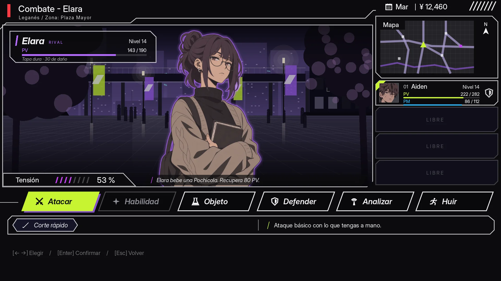
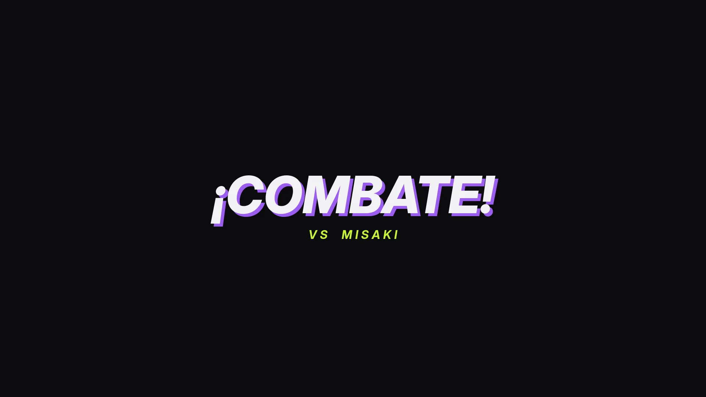
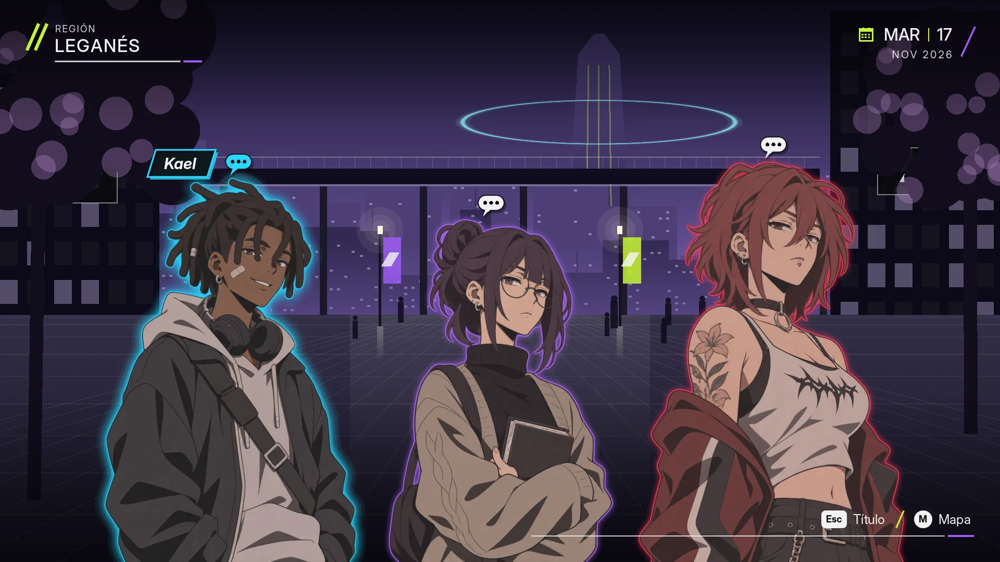
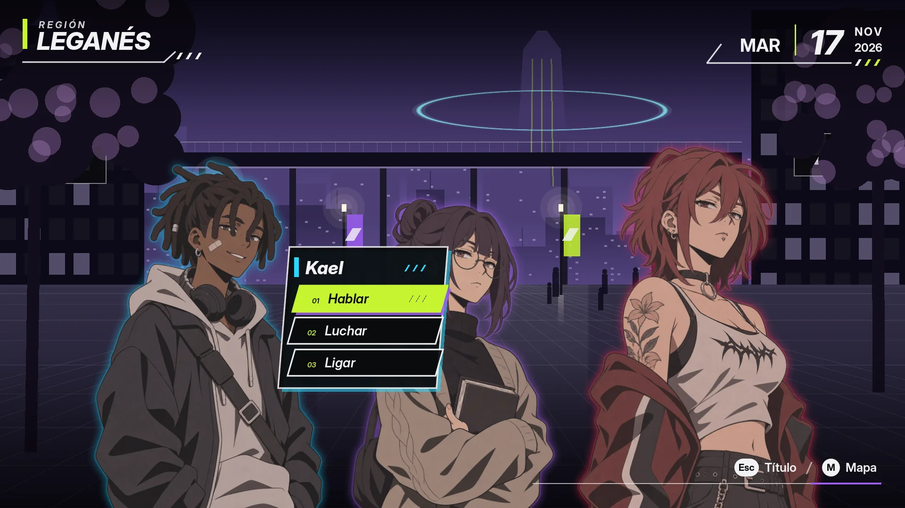
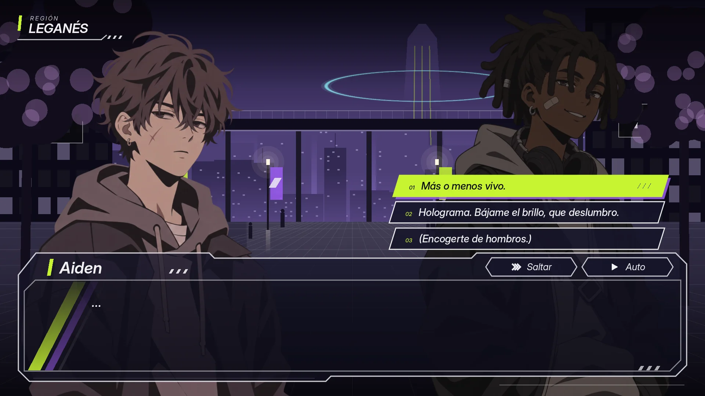

# Incursion From Beyond

JRPG híbrido con novela visual, ambientado en un mundo cotidiano y ligeramente futurista atravesado por entidades **biológicas, mecánicas, digitales, psíquicas y místicas**. Referencias: *Persona*, *Shin Megami Tensei*, *Digimon* y el cyberpunk.


## Requisitos

- [Godot 4.4](https://godotengine.org/download) o superior (versión estándar, sin .NET).

## Cómo ejecutarlo

1. Abre Godot → **Importar** → selecciona `project.godot`.
2. Pulsa **F5** (ejecutar proyecto). Arranca en el menú de inicio.

Desde terminal:

```bash
godot --path .
```

### Controles

| Acción | Teclado | Mando |
|---|---|---|
| Navegar / elegir personaje | Flechas | Cruceta / stick |
| Confirmar / avanzar diálogo | Enter / Espacio | A |
| Abrir / cerrar mapa | **M** | Y |
| Cerrar menú o mapa / volver al título | Esc | B |
| Pantalla completa | F11 / Alt+Enter | — |

El ratón también funciona: pasar por encima selecciona y el clic confirma (también para avanzar el diálogo).

## Qué se puede jugar (v0.3.0)

1. **Menú de inicio** → «Nueva partida».
2. **Introducción en negro**: «Despiertas un día más...».
3. **Tu habitación** (pantalla negra con la interfaz). Abajo a la derecha, el botón **(M) Mapa**.
4. **Mapa**: elige cualquier ubicación y viajas a ella. Cada una tiene su propio fondo.
5. **Escenario**: Kael, Elara y Misaki aparecen con una silueta brillante de su color. Al pasar el ratón o seleccionarlos con flechas se resaltan y muestran su nombre.
6. **Menú de interacción**: *Hablar*, *Luchar* o *Ligar*.
   - *Hablar*: conversación larga con opciones de diálogo que cambian la respuesta y la afinidad.
   - *Luchar*: el personaje acepta el reto → transición → **combate** → comentario de la pelea (distinto si ganas o pierdes).
   - *Ligar*: respuestas cortas y distintas para cada personaje.
7. **Conversación**: el protagonista (Aiden) siempre a la izquierda, el interlocutor a la derecha, sobre el mismo fondo de la ubicación. Botones *Saltar* y *Auto*.
8. **Combate** (1 contra 1, prototipo):
   - **Atacar** → *Corte rápido* (daño ~42).
   - **Habilidad** → bloqueada (aún no hay habilidades).
   - **Objeto** → *Pochicola* (empiezas con 3): restaura 80 PV a quien la bebe. El rival lleva una y la usa cuando va bajo de vida.
   - **Defender** → el próximo golpe hace la mitad de daño.
   - **Analizar** → revela PV y ataque del rival; no gasta el turno.
   - **Huir** → te rindes (cuenta como derrota).
   - El rival tiene un ataque propio con daño fijo (Kael 34, Elara 30, Misaki 38).
   - La *Tensión* es solo visual por ahora. Valores provisionales en `CharacterDB.combat`.



| | |
|---|---|
|  |  |
|  |  |

| | |
|---|---|
|  |  |
|  |  |
|  |  |

### Pendiente

- ✅ Interfaz de combate (prototipo 1 contra 1).
- ⬜ Habilidades, grupo de varios personajes y combate por naturalezas.
- ⬜ Interfaz de estado de personaje.
- ⬜ Mapa y fondos definitivos (los actuales son provisionales, generados por código).
- ⬜ Guardado de partida y opciones.
- ⬜ Sistema de naturalezas y asimilación ([documento de diseño](docs/diseno/sistema_de_naturalezas_y_asimilacion_parte_1.md)).

## Cómo añadir contenido

- **Diálogos**: `src/data/dialogue_db.gd`. Cada guion es una lista de líneas `{who, text}` con `id`, `goto`, `end` y `choices` opcionales (cada opción puede llevar `affinity`). El formato está documentado al principio del archivo.
- **Personajes**: `src/data/character_db.gd` (nombre, color del brillo, retrato y posición en el escenario). Los retratos están en `assets/characters/` (PNG con transparencia).
- **Combate**: estadísticas provisionales en `combat` de cada personaje (`character_db.gd`), objetos en `src/data/item_db.gd`, lógica en `src/systems/battle.gd` (sin interfaz: devuelve eventos que la vista anima).
- **Ubicaciones**: `src/data/location_db.gd` (nombre, descripción, posición en el mapa y paleta del fondo provisional).
- **Fondos reales**: deja `assets/backgrounds/<id>.png` (p. ej. `plaza.png`, 1920×1080) y sustituye automáticamente al fondo generado.

## Estructura

```
project.godot
assets/
  fonts/inter/            Tipografía Inter Display (licencia OFL, ver LICENSE.txt)
  characters/             Retratos de personajes (PNG con transparencia)
  backgrounds/            Fondos de ubicación opcionales (<id>.png)
src/
  autoload/               Singletons globales
    app.gd                  Tema por defecto, pantalla completa, versión
    game_state.gd           Estado de partida: región, fecha, ubicación, afinidad
    scene_router.gd         Cambio de pantalla y fundidos
  data/                   Datos del juego (sin lógica)
    location_db.gd          Ubicaciones
    character_db.gd         Personajes
    dialogue_db.gd          Guiones de conversación
    item_db.gd              Objetos (Pochicola)
  systems/
    battle.gd               Lógica de combate 1 contra 1 (eventos, sin interfaz)
  ui/
    ui_style.gd             Paleta, tipografías y utilidades de dibujo (UIStyle)
    ui_icons.gd             Iconos vectoriales (chevrons, play, calendario, bocadillo...)
    components/             Piezas reutilizables de interfaz
      slant_button.gd         Botón inclinado (lima al seleccionarse)
      region_header.gd        Cabecera «REGIÓN / LEGANÉS» (variantes mapa/escenario/compacta)
      date_header.gd          Cabecera de fecha (variantes mapa/escenario)
      info_bar.gd             Barra de descripción inferior
      dialogue_box.gd         Caja de diálogo (marco continuo, nombre, texto, Saltar/Auto)
      pill_button.gd          Botón píldora hexagonal con icono (Saltar / Auto)
      character_sprite.gd     Personaje con silueta brillante / atenuado
      hint_bar.gd             Atajos abajo a la derecha «(M) Mapa»
      key_hint_button.gd      Un atajo clicable
      name_tag.gd, toast.gd   Etiqueta de nombre y avisos breves
    shaders/
      background.gdshader     Fondo con grano, viñeta y destellos
      character_glow.gdshader Silueta + halo de color de los personajes
  screens/
    title/                  Menú de inicio
    world/                  Pantalla de juego: escenario, conversación, mapa
      world_screen.*          Orquesta los modos (intro, explorar, mapa, menú, hablar)
      location_backdrop.gd    Fondo de ubicación (imagen o generado)
      conversation_view.gd    Interfaz de conversación + intérprete de guiones
      interaction_menu.gd     Menú Hablar / Luchar / Ligar
      map_overlay.gd          Mapa superpuesto (M)
      map_view.gd             Dibujo del mapa provisional
      location_banner.gd      Cartel de llegada a una ubicación
      battle_transition.gd    Transición de combate (barrido diagonal + «¡COMBATE!»)
      combat/                 Interfaz de combate
        combat_view.gd          Composición, entrada (comando → opción) y animaciones
        combatant_card.gd       Ficha del grupo (PV/PM)
        enemy_plate.gd          Placa del rival
        mini_map.gd             Minimapa
        damage_popup.gd         Números de daño/curación
      talk_indicator.gd       Bocadillo «...» sobre los personajes interactuables
docs/
  diseno/                 Documentos de diseño de mecánicas
  ui/referencias/         Referencias visuales de cada interfaz
  capturas/               Capturas del estado actual
```

`docs/` tiene un `.gdignore` para que Godot no importe su contenido.

## Guía de estilo de interfaz

Las constantes están en `src/ui/ui_style.gd`:

| Uso | Color |
|---|---|
| Acento principal (selección, marcas) | Lima `#c6f432` |
| Acento secundario (sombras, río, rarezas) | Violeta `#9b5cf0` |
| Mazmorras / tensión | Magenta `#c23cf0` |
| Paneles | Negro `#0b0b0d` translúcido |
| Texto y líneas finas | Blanco `#f2f2f4` |

Rasgos recurrentes: texto en cursiva, formas en paralelogramo «/», marcas «///» y líneas blancas de 2 px con quiebro diagonal.

Los componentes son `@tool`, así que se ven tal cual en el editor de Godot.
