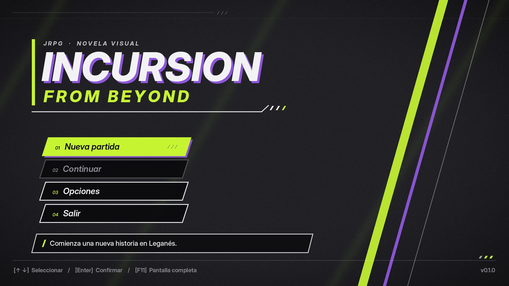
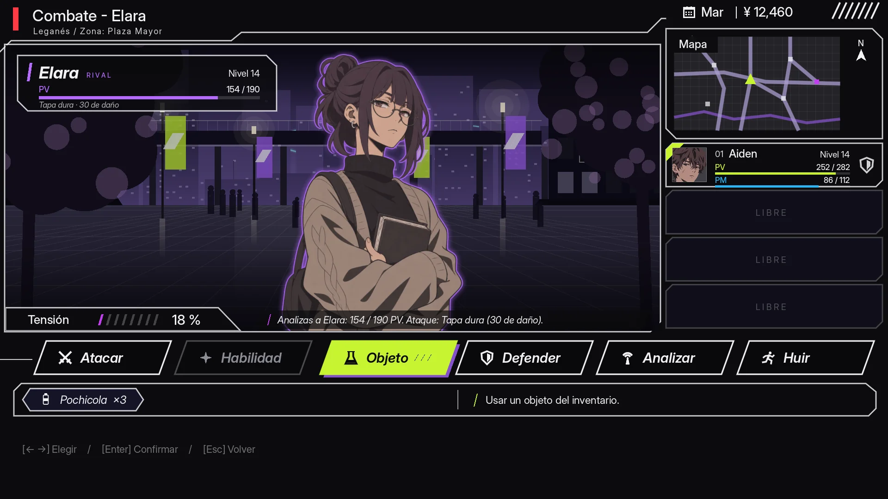
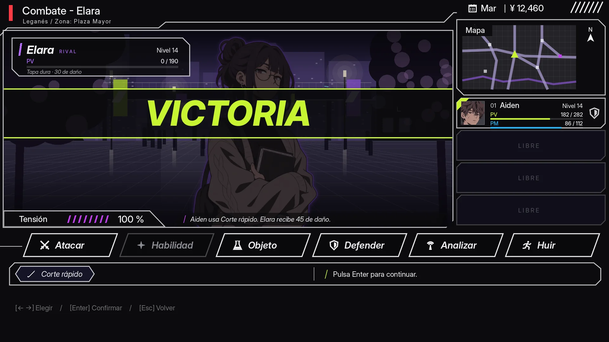
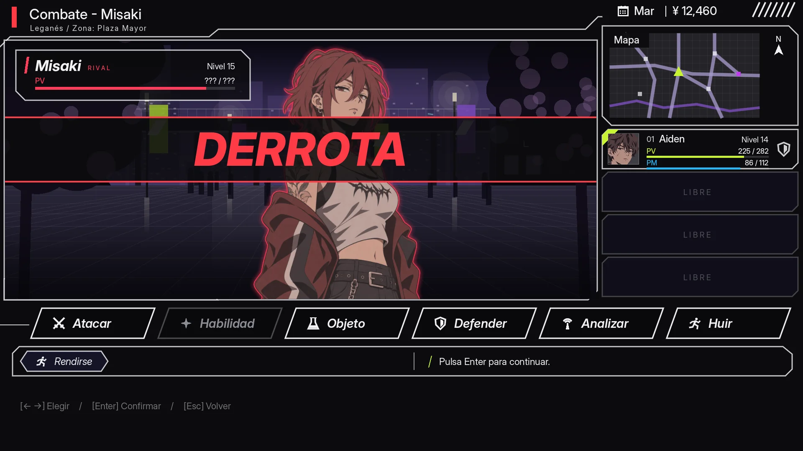
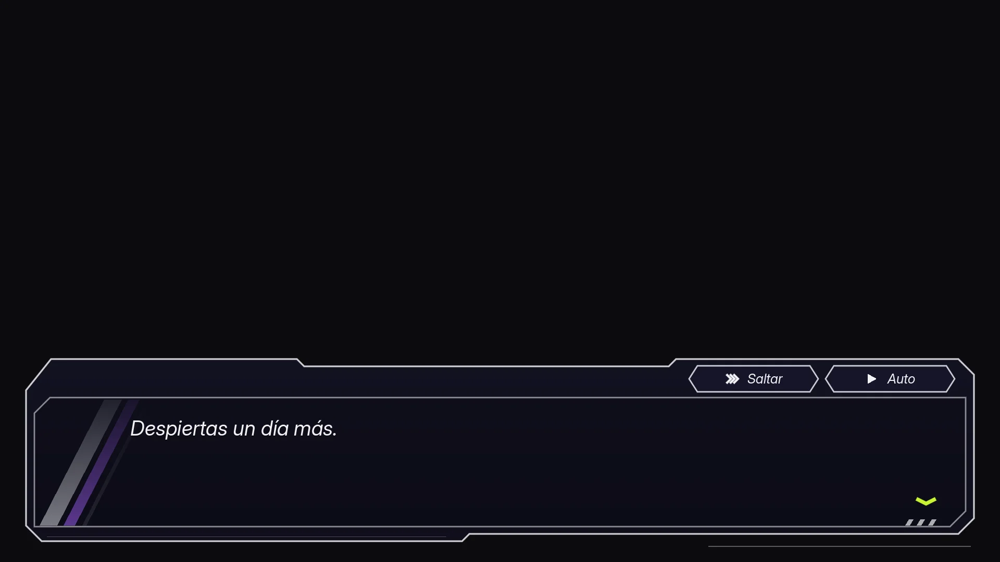
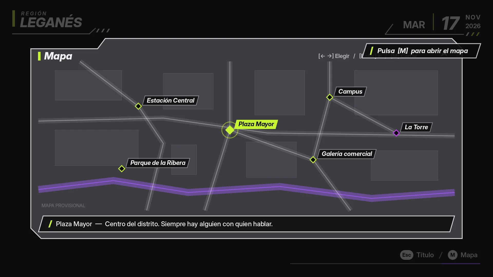
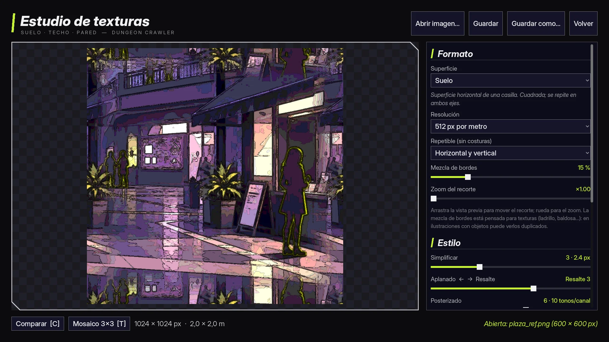
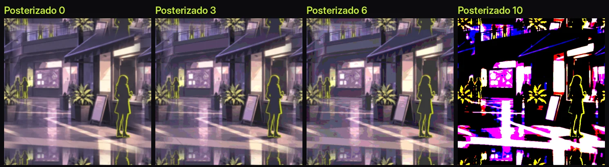
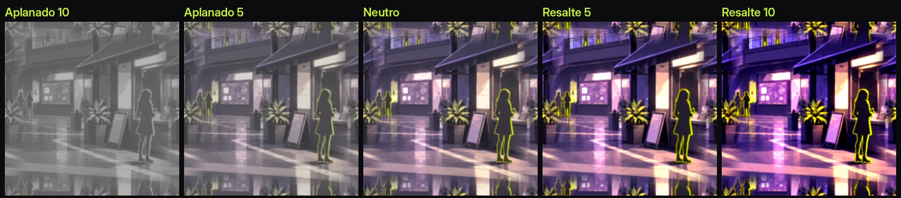

# Incursion From Beyond

JRPG híbrido con novela visual, ambientado en un mundo cotidiano y ligeramente futurista atravesado por entidades **biológicas, mecánicas, digitales, psíquicas y místicas**. Referencias: *Persona*, *Shin Megami Tensei*, *Digimon* y el cyberpunk.



## Requisitos

- [Godot 4.7](https://godotengine.org/download) (versión estándar, sin .NET).
- Al clonar, activa los hooks de git del proyecto (una vez por copia):
  ```bash
  git config core.hooksPath .githooks
  ```
  Impiden subir cambios sin actualizar el contexto de `CLAUDE.md` (ver ese archivo).

## Cómo ejecutarlo

1. Abre Godot → **Importar** → selecciona `project.godot`.
2. Pulsa **F5** (ejecutar proyecto). Arranca en el menú de inicio.

Desde terminal:

```bash
godot --path .
```

### Controles

| Acción | Teclado | Mando |
|---|---|---|
| Navegar / elegir personaje | Flechas | Cruceta / stick |
| Confirmar / avanzar diálogo | Enter / Espacio | A |
| Abrir / cerrar mapa | **M** | Y |
| Cerrar menú o mapa / volver al título | Esc | B |
| Pantalla completa | F11 / Alt+Enter | — |

El ratón también funciona: pasar por encima selecciona y el clic confirma (también para avanzar el diálogo).

## Qué se puede jugar (v0.3.0)

1. **Menú de inicio** → «Nueva partida».
2. **Capítulo 1, día 1 (lunes 16 de noviembre)**. Es un día guiado: un aviso dice el objetivo, en el mapa solo se puede ir a ese destino (los demás responden «Ahora no») y no hay combates ni gente suelta por el mapa.
   - Despiertas con la alarma; Kenji te escribe al móvil. *Objetivo: ve al instituto*.
   - *Instituto*: Kenji pregunta qué tal el finde; llega Yuna, su novia, le abraza por la espalda y se llaman «osito», «cariño», «cielo»; luego llegan Rika y Shiori y entra la profesora («Sentaos... toca aprender a derivar»). Kenji: «Qué coñazo». Shiori: «Espabila, que al final no llegas a selectividad». Fundido a negro, suena el timbre y quedan para ir a las camas elásticas. Mates II es la única asignatura en la que juntan las dos clases, por eso Kenji está en el aula.
   - *Objetivo: ve a Westfield Parquesur con el grupo*. Camas elásticas, fundido y despedida.
   - *Objetivo: vuelve a casa*. «Buah... Estoy hecho polvo.» Ren se duerme.
   - Las escenas están en `src/dialogue/capitulo1.dialogue` y los pasos en `src/data/chapter_db.gd`.
3. **Día 2 (martes)**: introducción en negro, «Despiertas un día más...», y a partir de aquí el juego libre de siempre.
4. **Casa** (la habitación de Ren). La pantalla, la estantería y la cama tienen contorno: al pasar el ratón se resaltan y abren un menú con *Examinar*, que muestra lo que piensa Ren de cada cosa. Abajo a la derecha, el botón **(M) Mapa**. En el mapa aparece como *Casa*, y allí no hay nadie.
5. **Mapa**: elige cualquier ubicación (con clic en el rombo o en su nombre) y viajas a ella. Cada una tiene su propio fondo.
6. **Escenario**: cada ubicación tiene su gente, con una silueta brillante de su color. Al pasar el ratón o seleccionarlos con flechas se resaltan y muestran su nombre.
   - *Plaza Mayor*: Kenji y Rika. *Campus*: Shiori. *Westfield Parquesur*: Akane.
   - *Estación de Zarzaquemada*, *Parque de la Ribera* y *La Torre* están vacías: al llegar, temblor y combate contra un enemigo al azar.
   - *Instituto*: el aula de Ren, Rika y Shiori. Fuera de horario está vacía, pero es un lugar seguro (no hay combate).
7. **Menú de interacción**: *Hablar*, *Luchar* o *Ligar*.
   - *Hablar*: conversación larga con opciones de diálogo. Cada opción tiene un estilo (franco, bromista, reservado...) y los presentes reaccionan por detrás según su personalidad.
   - *Luchar*: el personaje acepta el reto → fundido → **combate** → comentario de la pelea (distinto si ganas o pierdes).
   - *Ligar*: respuestas cortas y distintas para cada personaje.
8. **Conversación**: el protagonista (Ren) siempre a la izquierda, el interlocutor a la derecha, sobre el mismo fondo de la ubicación. Botones *Saltar* y *Auto*.
9. **Combate** (1 contra 1, prototipo):
   - **Atacar** → *Corte rápido* (daño ~42).
   - **Habilidad** → *Impulso orgánico* (ataque) y *Regeneración celular* (curación), de la naturaleza Biológica. Gastan PM; la curación tiene 2 turnos de recarga. Fórmulas en `SkillDB` (ver `docs/diseno/habilidades_1.md`).
   - **Objeto** → *Pochicola* (empiezas con 3): restaura 80 PV a quien la bebe. El rival lleva una y la usa cuando va bajo de vida.
   - **Defender** → el próximo golpe hace la mitad de daño.
   - **Analizar** → revela PV y ataque del rival; no gasta el turno.
   - **Huir** → te rindes (cuenta como derrota).
   - El rival tiene un ataque propio con daño fijo (Kenji 34, Shiori 30, Akane 38).
   - La *Tensión* es solo visual por ahora. Valores provisionales en `CharacterDB.combat`.
   - **Ficha de estado**: en «Estado» solo salen los estados alterados que tienes (o «Normal» si no tienes ninguno). Al pasar el ratón por uno aparece un tooltip con qué hace, los PV que quita por turno y los turnos que le quedan. Los textos están en `SkillDB.STATUS_DESC`.
   - **Recompensa**: al ganar, recibes ¥ = nivel de la criatura × 120, con un +15 % por cada nivel que la criatura te saque y un −15 % por cada nivel que tú le saques (mínimo, el 10 %). Ejemplos: misma altura, nivel 15: ¥ 1.800; criatura 10 niveles por encima: ¥ 4.500; 10 niveles por debajo: ¥ 180. Se ve bajo «VICTORIA» y se suma a la cabecera. Constantes en `Battle.REWARD_*`.
10. **Primera incursión**: al hablar con el **segundo personaje distinto**, la conversación se corta con un temblor y aparece una criatura, elegida al azar en cada partida:
   - **Tiranosaurio mutante** (Digital): *Corrupción de datos* y *Depuración*.
   - **Oni** (ARQ): *Manifestación arcana* y *Marca funesta* (maldición que hace daño durante 3 turnos).
11. **Enemigos aleatorios** (ubicaciones vacías): los dos anteriores y además
   - **Engendro** (Biológico): *Impulso orgánico* y *Secreción cáustica* (corrosión: RES −8 % durante 2 turnos).
   - **Turbina** (Mecánico): *Impacto cinético* y *Proyección de fragmentos*.
   - **Crawler** (Mecánico): torreta cuadrúpeda. Mismas técnicas que la Turbina.
   - **Imp** y **Querubín** (ARQ): *Manifestación arcana* y *Marca funesta*.
   - **Troyano** (Digital): *Corrupción de datos* y *Depuración*.
   - La naturaleza que antes se llamaba «Místico» se muestra ahora como **ARQ** (arquetípica: mitos, símbolos y leyendas encarnados). En el código sigue siendo `mystic`.
12. **Primer combate contra una criatura**: luchas con un compañero (el personaje con el que hablabas en la incursión, o uno al azar) que lleva 2 habilidades al azar de todo el catálogo, sin importar su naturaleza. Cada miembro del grupo elige su acción en su turno (la ficha activa se resalta) y después actúa el rival.

En combate, los comandos (*Atacar*, *Habilidad*, *Objeto*...) se eligen con clic o con el teclado; pasar el ratón por encima solo cambia la opción resaltada del submenú.

**Franjas del día**: el día tiene cuatro franjas (*mañana*, *día*, *tarde* y *noche*), que se ven en la cabecera de la fecha (`GameState.TIME_SLOTS`). Las actividades pasan a la siguiente: la clase (mañana → día) y las camas elásticas (día → tarde), marcadas con `advance_time` en `ChapterDB`. La **cama** de casa tiene, además de Examinar:
- **Siesta**: pasa una franja (de noche, equivale a dormir);
- **Dormir**: hasta la mañana siguiente, desde cualquier franja.
Durante un objetivo del guion la cama responde «Ahora no». Al pasar al día siguiente sale una animación (`DayTransition`): un reloj corre hasta las 7:00 y la hoja del calendario cambia de número y de día de la semana.

**Móvil («Terminal»)**: botón *T Terminal* abajo a la derecha, junto a *Mapa* (o tecla T). Solo se abre explorando, nunca en combate ni en conversación. Oscurece la escena y muestra la hora, el clima y las apps sobre el fondo de pantalla (`assets/phone/fondo.png`, con un velo oscuro para que se lea la interfaz). Se navega con ratón o flechas + Enter; *Esc* o el botón «<» vuelven atrás y *T* o un clic fuera lo cierran.
   - *Contactos*: Kenji, Rika, Shiori, Akane, Yuna y Mamá. Al elegir uno se abre el chat y puedes **saludar**: Ren escribe y el contacto responde tras un «escribiendo...». La respuesta sale del selector de diálogos (momento `movil` en el `.dialogue` de cada uno) y cambia según su ánimo, la relación, si ya le has escrito hoy y si pasó la incursión.
   - *Mensajes*: solo aparecen las conversaciones que ya existen, de la más reciente a la más antigua. Se guardan en la partida.
   - *Relaciones*: cómo está cada personaje con Ren: el tramo (Hostil, Fría, Neutral, Cercana o Íntima), su ánimo de hoy, barras de afecto, confianza y respeto, y además atracción, miedo, asco o resentimiento si destacan. Salen Kenji, Rika, Shiori, Akane, Yuna, Mamá y la madre de Kenji.
   - *Inventario*: los objetos que llevas, con cantidad y descripción.
   - *Equipo*: arma, accesorio y módulo de Ren y sus compañeros (de momento solo se muestran; no afectan al combate).
   - *Misiones*, *Ajustes* y *Criaturas* aún no tienen contenido (referencias en `docs/ui/referencias/07_*`–`11_*`).

**Pantalla de estado**: en combate, clic en una ficha del grupo (o *Tab*, para quien está eligiendo) abre la pantalla del personaje. Muestra la ilustración en grises, el nivel, la naturaleza, los PV y PM, los atributos, las habilidades con su detalle (potencia, objetivo, recarga) y los estados alterados. La pestaña *Historia* cuenta quién es. Se cambia de miembro con las miniaturas, las flechas o AvPág/RePág, y se cierra con la X, *Esc*, *Tab* o un clic fuera.


| | |
|---|---|
|  |  |
|  | |

| | |
|---|---|
|  |  |
|  |  |
|  |  |

### Pendiente

- ✅ Interfaz de combate (prototipo 1 contra 1).
- ⬜ Habilidades, grupo de varios personajes y combate por naturalezas.
- ⬜ Interfaz de estado de personaje.
- ⬜ Mapa y fondos definitivos (los actuales son provisionales, generados por código).
- ✅ Guardado automático y «Continuar» (al llegar a una ubicación y tras cada interacción).
- ⬜ Opciones.
- ⬜ Relaciones, ánimo y cansancio de los personajes ([borrador](docs/diseno/personajes_y_relaciones.md)).
- ⬜ Sistema de naturalezas y asimilación ([documento de diseño](docs/diseno/sistema_de_naturalezas_y_asimilacion_parte_1.md)).

## Mapa 3D de Leganés

El mapa del juego (tecla **M**) es un modelo 3D de Leganés generado por código a partir de OpenStreetMap. Es como una maqueta: va recortada en rectángulo y tiene base, así que no asoma nada por los lados. Lleva una capa gris por encima y los rombos de las ubicaciones en 2D. Arriba se ven el día y la franja (mañana, día, tarde o noche).

- **Vista**: sale siempre recta (norte arriba) y con el mapa entero; la distancia se calcula sola.
- **Zoom**: rueda, pellizco o las teclas **+ / −** acercan hacia el ratón, y arrastrando te mueves. Con el teclado, el mapa sigue a la ubicación elegida.
- **Cambios del editor**: al abrir el mapa se relee `src/data/mapa3d.json` si ha cambiado, así que lo que guardas en el editor se ve aunque el juego ya esté abierto.

- **Luz según la franja del día**: cada franja usa una hora (mañana 8:00, día 13:00, tarde 19:30, noche 23:00). La luz se mezcla poco a poco entre cuatro momentos:
  - *Amanecer*: luz blanca y baja.
  - *Día*: luz alta.
  - *Atardecer*: luz anaranjada y rasante, con sombras largas.
  - *Noche*: luz global azul oscura y ventanas encendidas en los edificios.
- **Datos**: `assets/map/leganes.json` (edificios con altura, calles, zonas verdes, agua y vías, en metros). Cómo se regeneran: `tools/maps3d/README.md`.
- **Código**: `src/map3d/`:
  - `CityBuilder` construye las mallas (recorte, base y luces de las ventanas);
  - `CityMap` monta cámara, luz y marcadores;
  - `MapConfig` guarda los ajustes en `src/data/mapa3d.json` y calcula la luz de cada hora.
- **Editor**: abre `src/tools/editor_mapa/editor_mapa.tscn` en Godot y pulsa **F6**. La vista tiene la misma proporción que el mapa del juego.
  - **Ubicaciones**:
    - elige una en la lista y haz clic en el mapa para colocarla; los marcadores también se pueden arrastrar;
    - **Nombre** y **Descripción** cambian lo que se ve en el juego;
    - **+ Nuevo punto** crea una ubicación nueva. Al ir allí se ve el fondo genérico y, como no hay nadie, salta un combate;
    - **Quitar** borra solo la posición;
    - **Borrar** la quita del mapa: un punto nuevo se elimina del todo, y una ubicación del juego pasa a «Borradas del mapa», desde donde se puede **Recuperar**;
    - la casa y los destinos de la historia (instituto y Westfield Parquesur) no se pueden borrar;
    - las ubicaciones sin colocar salen con «(?)» en una posición provisional.
  - **Vista**: solo se guardan la **inclinación** y el **campo de visión**. Con el ratón puedes girar (clic derecho), hacer zoom (rueda o pellizco) y moverte (clic central, dos dedos o WASD) para trabajar, pero eso no se guarda. «Ver como en el juego» vuelve al encuadre del juego. También están aquí la intensidad y el color de la capa gris.
  - **Iluminación según la hora**:
    - «Ver a las» cambia la hora de la vista previa;
    - con los botones Amanecer, Día, Atardecer y Noche eliges qué momento editas: su hora, la dirección, altura, intensidad y color de la luz, la luz ambiente y cuántas ventanas se encienden;
    - las sombras se activan o desactivan para todo el día.
  - **Colores del modelo**: suelo, edificios, calles, aceras, zonas verdes, agua, vías, base de la maqueta y ventanas.
  - **Guardar** (o Cmd+S) escribe `src/data/mapa3d.json`.
- El minimapa del combate sigue usando el mapa provisional.
- Los datos son © colaboradores de OpenStreetMap (licencia ODbL). El crédito sale en la esquina del mapa.

## Herramientas

### Estudio de texturas (`src/tools/texture_studio/`)

Prepara imágenes como texturas de **suelo**, **techo** y **pared** para el dungeon crawler ([documento de diseño](docs/diseno/Diseno_Dungeon_Crawler_Godot.md)).

**Abrirlo:** ejecuta el juego desde el editor de Godot y pulsa **«Estudio de texturas»** arriba a la derecha del menú de inicio, o abre `src/tools/texture_studio/texture_studio.tscn` y pulsa **F6**. Solo funciona desde el editor, porque guarda archivos dentro del proyecto.

| Control | Qué hace |
|---|---|
| **Superficie** | Suelo / Techo (2 × 2 m, cuadrada) o Pared (2 × 2,5 m). Recorta la imagen a esa proporción. |
| **Resolución** | 256 / 512 / 1024 px por metro (suelo a 512 → 1024 × 1024 px). |
| **Repetible** | Mezcla los bordes para que la textura se repita sin costuras: en ambos ejes (suelo, techo) o solo en horizontal (pared). |
| **Zoom del recorte** | Arrastra la vista previa para elegir qué parte de la imagen usar; rueda para acercar. |
| **Simplificar** | Desenfoque previo que funde el ruido fino en manchas, para que el posterizado y las líneas sigan las formas grandes. |
| **Aplanado ← → Resalte** | Quita (−) o añade (+) saturación y contraste. |
| **Posterizado** | 0 = desactivado … 10 = 2 tonos por canal. |
| **Entintado** | 1 = sin líneas … 10 = todas las formas repasadas, estilo anime. Con grosor y color de línea (oscuro de cada forma o tinta). |

- **Comparar [C]** (mantener) muestra la imagen original. **Mosaico [T]** muestra la textura repetida en 3×3 para revisar costuras.
- **Guardar** escribe `assets/textures/<tema>/<superficie>/<nombre>.png` y, a su lado, un `.estilo.json` con los ajustes usados, para repetir el mismo estilo en otras texturas. **Guardar como…** permite elegir cualquier ruta.
- Puedes abrir imágenes con el botón o arrastrándolas a la ventana.
- Las medidas (casilla de 2 m, pared de 2,5 m, densidades) están en `src/data/texture_formats.gd` y las compartirá el editor de mapas.







### Editor de mazmorras (`src/tools/editor_mazmorras/`)

Dibuja mapas del dungeon crawler sobre un plano por casillas y los convierte en escenarios 3D ([documento de diseño](docs/diseno/Diseno_Dungeon_Crawler_Godot.md)). Usa las texturas del Estudio de texturas.

**Abrirlo:** ejecuta el juego desde el editor de Godot y pulsa **«Editor de mazmorras»** arriba a la derecha del menú de inicio, o abre `editor_mazmorras.tscn` y pulsa **F6**.

| Herramienta | Qué hace |
|---|---|
| **Casillas [1]** | Clic izquierdo pinta (suelo y techo), derecho borra; se puede arrastrar. Las paredes del contorno salen solas. |
| **Muros [2]** | Clic en el borde entre dos casillas pintadas: muro. Clic derecho lo quita. Se puede arrastrar. |
| **Puertas [3]** | Clic en el borde entre dos casillas pintadas: puerta. Si ya hay una, la selecciona y se edita en «Selección»: estado inicial y objeto necesario (id del inventario). Clic derecho la quita. |
| **Texturas [4]** | Elige superficie (suelo, techo, pared) y textura de la paleta. La pared se pinta por cara: cada lado de un muro puede llevar una distinta. Clic derecho: vuelve a la del tema. Con «Suelo», **R** (o Mayús+R) gira el suelo de la casilla bajo el ratón, p. ej. para que una flecha apunte a la escalera. |
| **Inicio [5]** | Casilla de salida (en la planta que estás editando); clic otra vez para girar la orientación. |
| **Enemigos [6]** | Pone el enemigo elegido (los de `CharacterDB` con `enemy`) en una casilla; clic derecho lo quita. En el plano sale su cara; en 3D, su retrato de pie. |
| **Objetos [8]** | Deja en el suelo el objeto elegido (de `ItemDB`) con su cantidad. En el juego se coge desde la casilla de al lado. Clic derecho lo quita. |
| **Interruptores [9]** | Pone una palanca (bloquea el paso) o la selecciona. Con una seleccionada, clic en una puerta para vincularla o desvincularla: al accionarla, abre o cierra todas sus puertas. Clic derecho la quita. Una puerta puede marcarse como «Solo se abre con una palanca» o como **«Secreta»**: parece una pared más (en el plano, muro con trazos violeta) hasta que el jugador la examina con Usar; entonces se hunde y deja el paso abierto. |
| **Escaleras [7]** | Escalera que sube o baja hacia donde apunta la flecha (se entra andando en esa dirección). Crea la planta de arriba o de abajo si no existe, y la escalera de vuelta en la misma casilla. Clic otra vez para girarla, clic derecho la quita (con su pareja). |

- **Plantas**: «Planta» en el panel (▼ ▲, «+ Encima», «+ Debajo», «Borrar planta») o **Re Pág / Av Pág**. La planta de debajo se ve en gris para alinear. Solo se puede borrar la de arriba o la de abajo del todo.
- **Plano**: rueda o pellizco para el zoom, clic central o dos dedos para moverte.
- **Vista 3D**: muestra la planta que editas y se regenera con cada cambio. Clic derecho para girar, rueda para el zoom, «Techo» lo muestra u oculta.
- **Probar mapa [P]**: recorre el mapa en primera persona desde el inicio. W/S avanzar y retroceder, A/D girar 90°, Q/E paso lateral, Espacio abre o cierra la puerta de delante, Esc vuelve al editor. Al chocar con un enemigo (o pulsar Espacio delante) empieza el combate de verdad; si ganas, desaparece. Al entrar en una escalera cambias de planta.
- **Cmd/Ctrl+Z** deshace (cada trazo es un paso), **Cmd/Ctrl+Shift+Z** rehace y **Cmd/Ctrl+S** guarda en `src/data/mazmorras/<nombre>.json`. Hay un mapa de ejemplo (`ejemplo`): pasillo en L, puerta, sala con un Oni y escalera a una segunda planta con un pasillo y otro enemigo.

### Modo mazmorra en el juego (`src/screens/dungeon/`)

- Al viajar a **La Torre** sale una escena con dos opciones: **«Entrar en la torre»** o **«Pensarlo mejor»** (cue `torre_llegada` en `general.dialogue`). Si te lo piensas, sigues en la Torre y puedes volver a intentarlo con **«Entrar» [E]** en la barra de abajo.
- Al entrar empieza el **modo mazmorra** (`DungeonScreen`) con la interfaz del combate: cabecera, visor grande con la vista 3D, automapa en el hueco del minimapa, fichas del grupo, comandos (**Usar, Objetos, Mapa, Salir**) y barra de descripción y registro.
- **Interactuar**: lo que hay justo delante (la puerta de ese borde, o la criatura, objeto o palanca de la casilla de delante) se recuadra en lima con una etiqueta («Abrir · Puerta cerrada», «Luchar · Imp», «Coger · Pochicola», «Accionar · Palanca»). Se usa con **clic encima**, **Espacio** o el comando **Usar**. Las criaturas también saltan al chocar con ellas; el combate es el de siempre y, si pierdes, retrocedes una casilla.
- **Grupo**: entras con un **compañero al azar** (Kenji, Shiori, Akane o Rika) que aparece en las fichas de la derecha y lucha a tu lado en cada combate. **Clic en una ficha** (o **Tab**) abre su pantalla de estado, la misma del combate.
- **Comentarios**: el compañero habla de vez en cuando en el registro del visor, con su nombre y su voz: al entrar, al andar, ante una criatura, al coger algo, al cambiar de planta, ante una puerta cerrada, al accionar una palanca y, sobre todo, junto a una pared falsa (es la pista). Las frases están en `src/data/dungeon_banter.gd`.
- **Paredes falsas**: delante de una, **Usar** la empuja y se abre un pasadizo.
- **Controles**: W/S avanzar y retroceder, A/D girar, Q/E de lado, M automapa, Tab equipo, Esc salir.
- **La Torre**: planta 0 con vestíbulo, pasillo con puerta de palanca, sala de la palanca (con un pasadizo secreto en la pared oeste que guarda la **Tarjeta de acceso**), ala este con un almacén y una cámara cerrada con tarjeta, y la sala de la escalera; planta 1 con el pasillo del cartel, la sala del Oni, el laboratorio (cerrado con tarjeta) y un pasillo al este con otro hueco secreto al fondo.
- El mapa de cada mazmorra es `dungeon_map` en `LocationDB` (La Torre usa `src/data/mazmorras/torre.json`, editable con el editor) y `battle_background` el fondo de sus combates (La Torre: `assets/backgrounds/torre_mazmorra.png`).
- Texturas de La Torre (tema `torre`): ocho paneles de pared (`panel_1`…`panel_8`; el predeterminado es `panel_1` y el resto se reparte por las caras) y el suelo `salida`, solo en la casilla de delante de cada escalera con la flecha hacia ella. En `tema.json`, `"suelo": ""` indica que el suelo normal no usa ninguna de las del tema (sale el provisional). El progreso (puertas, criaturas vencidas, objetos cogidos y casillas vistas del automapa) se guarda en la partida (`GameState.dungeons`); al volver se empieza en la entrada. Salir pasa a la franja siguiente del día (salvo de noche).

**Con el Estudio de texturas:**
- El **tema** del mapa es una carpeta de `assets/textures/<tema>/`; la paleta muestra lo que hay en `suelo/`, `techo/` o `pared/`.
- **«Estudio de texturas»** abre el Estudio con ese tema y esa superficie ya elegidos. Al pulsar «Volver» regresas al editor con el mapa tal como estaba, aunque no lo hubieras guardado, y las texturas nuevas ya aparecen en la paleta.
- **«Usar como predeterminada del tema»** la guarda en `assets/textures/<tema>/tema.json`. Las superficies sin textura propia usan la predeterminada; si cambias de tema, cambian con él. Si el tema no tiene texturas, se usan unas provisionales (damero y ladrillo).
- Cada textura ocupa exactamente una casilla (2 × 2 m) o un tramo de pared (2 × 2,5 m), con las mismas medidas que el Estudio (`TextureFormats`).

### Editor de relieve (`src/tools/editor_relieve/`)

Da un poco de volumen a una textura, como en los juegos antiguos: marcas qué zonas salen y cuáles se meten, y en 3D las placas se desplazan según el ángulo (parallax) y sus bordes cogen luz y sombra (normal map). La pared sigue siendo plana, así que no cuesta geometría.

- **Abrirlo:** botón **«Relieve de la textura…»** bajo la paleta del editor de mazmorras (abre la textura elegida; «Volver» regresa con el mapa como estaba), o `src/tools/editor_relieve/editor_relieve.tscn` con **F6**.
- **Niveles** [1–4], de dentro a fuera: **Hueco**, **Base**, **Placa** y **Placa saliente**. Clic derecho pone Base (borra).
- **Herramientas:** **Rellenar zona [F]** (clic en una placa y se rellena lo unido de color parecido; se frena en las juntas y tapa los agujeros del óxido; si se escapa o se queda corto, cambia la tolerancia), **Lazo [L]** (clic a clic pones puntos por el borde; se cierra con clic en el primero, doble clic o Intro y se rellena lo de dentro; clic derecho o Retroceso quita el último punto, Esc cancela), **Rectángulo [R]** y **Pincel [B]**.
- **«Partir de la imagen»** hace un primer intento según lo claro y lo oscuro; **G** muestra el relieve en grises. A la derecha, una vista previa 3D con la luz en movimiento.
- **Profundidad** (de todo el tema, `"relieve"` en `tema.json`) y **suavizado** de los bordes.
- Guarda en `assets/textures/<tema>/<superficie>/relieve/`: `<nombre>.png` (altura en grises, la que usa el juego) y `<nombre>.niveles.png` (los niveles, para seguir editando). Las texturas sin relieve se ven planas como antes.

**Código** (`src/dungeon/`), pensado para usarlo también en el juego:
- `DungeonMap`: datos y reglas de paso, por plantas. Cada casilla es dueña de sus bordes norte y oeste, así que una puerta es la misma vista desde los dos lados. Enemigos y escaleras son «cosas» de una casilla.
- `DungeonBuilder`: genera la geometría, con una malla por textura y las UV según la posición en el mundo.
- `DungeonExplorer`: movimiento por casillas con cola de una acción, choque con los muros, escaleras entre plantas, lo que hay delante (`front()`) y su uso (puertas, palancas, objetos, encuentros con la señal `encounter`), estado guardable y luz del grupo.
- `DungeonTextures`: temas, paleta, texturas predeterminadas y relieve (`relief_for`). En el juego carga las texturas importadas; el editor activa `live_files` para leer los PNG recién exportados.

### Editor de diálogos (web, también en el móvil)

App web en `docs/editor-dialogos/`. Lee los diálogos del repositorio en GitHub, permite cambiar **qué conversación sale y cuándo** y guarda los cambios en el repo. Funciona en el navegador del móvil y del ordenador; en el móvil, «Añadir a pantalla de inicio» lo deja como una app.

- **Diálogos**: lista de todos los cues con buscador, filtro por personaje y por momento, y avisos si algo está mal.
- **Editar**: las reglas `# cuando:` con controles (momento, fase, ánimo, tramo, dimensiones de la relación, «una vez», «visto», «sabe», indicadores, presentes, interacciones de hoy, resultado del combate, y «no» para negar), una frase que explica cuándo sale, el peso y la puntuación. El texto del diálogo con atajos y vista previa. Crear, renombrar (actualiza los `visto` y `=>` que lo usan), mover de archivo y borrar.
- **Simular**: eliges personaje, momento y situación (fase, ánimo, relación, interacciones, resultado, presentes, lo que sabe, indicadores, lo ya visto) y dice qué diálogo sale, con qué puntuación y por qué falla cada uno de los demás. Usa el mismo selector que el juego (comprobado con `tools/editor_dialogos/paridad.sh`). «Inicio de partida» parte de las fichas; «Cargar partida…» lee un `partida.json`.
- **Guardar**: muestra las diferencias y sube un solo commit a `main` (solo los cues tocados cambian en el archivo). Si alguien ha cambiado ese archivo en GitHub mientras tanto, no sube nada y avisa. Sin conexión: abre `.dialogue` locales y descárgalos.
- **Token**: para guardar hace falta un *fine-grained token* de GitHub (github.com → Settings → Developer settings → Fine-grained tokens → Generate new token):
  - *Repository access* → *Only select repositories* → este repositorio.
  - *Permissions* → botón **+** → marca **Contents** → cambia su acceso de *Read-only* a **Read and write**. *Metadata* (solo lectura) se añade sola; no hace falta nada más.
  - Pégalo en la app en ⋯ → Ajustes. Se guarda solo en ese navegador.

## Cómo añadir contenido

- **Diálogos**: `src/dialogue/*.dialogue` (plugin [Dialogue Manager](https://github.com/nathanhoad/godot_dialogue_manager), en `addons/`). Uno por personaje más `general.dialogue`. Cada conversación lleva una regla `# cuando:` que decide cuándo sale; ver [el documento de diseño](docs/diseno/personajes_y_relaciones.md).
- **Personajes**: `src/data/character_db.gd` (nombre, color del brillo, retrato y posición en el escenario). La personalidad, las reacciones y las relaciones iniciales van en una ficha `src/data/characters/<id>.json` (Rika, Kenji, Shiori, Akane, Yuna, Mamá y la madre de Kenji). Yuna es la novia de Kenji y está en su clase. Mamá (`madre_ren`) y la madre de Kenji (`madre_kenji`) son amigas. Durante el guion del capítulo 1, los que reaccionan a las opciones de Ren son los del `cast` de cada paso (`chapter_db.gd`). Los retratos están en `assets/characters/` (PNG con transparencia).
- **Combate**: estadísticas provisionales en `combat` de cada personaje (`character_db.gd`), objetos en `src/data/item_db.gd`, lógica en `src/systems/battle.gd` (sin interfaz: devuelve eventos que la vista anima).
- **Ubicaciones**: `src/data/location_db.gd` (nombre, descripción, posición en el mapa y paleta del fondo provisional).
- **Fondos reales**: deja `assets/backgrounds/<id>.png` (p. ej. `plaza.png`, 1920×1080) y sustituye automáticamente al fondo generado.

## Estructura

```
project.godot
addons/dialogue_manager/  Plugin Dialogue Manager 4.2 (MIT)
assets/
  fonts/inter/            Tipografía Inter Display (licencia OFL, ver LICENSE.txt)
  characters/             Retratos de personajes (PNG con transparencia)
  backgrounds/            Fondos de ubicación opcionales (<id>.png)
src/
  autoload/               Singletons globales
    app.gd                  Tema por defecto, pantalla completa, versión
    game_state.gd           Estado de partida: región, fecha, ubicación, fase de la historia, indicadores, guardado
    story.gd                Puente con los diálogos y selector de conversaciones
    scene_router.gd         Cambio de pantalla y fundidos
  data/                   Datos del juego (sin lógica)
    location_db.gd          Ubicaciones
    character_db.gd         Personajes
    item_db.gd              Objetos (Pochicola)
    texture_formats.gd      Medidas y formatos de textura del dungeon crawler
  systems/
    battle.gd               Lógica de combate del grupo contra un rival (eventos, sin interfaz)
    event_log.gd            Registro de acontecimientos: qué pasó y quién lo sabe
    social.gd               Relaciones, ánimo y cansancio: cómo reaccionan los personajes
  ui/
    ui_style.gd             Paleta, tipografías y utilidades de dibujo (UIStyle)
    ui_icons.gd             Iconos vectoriales (chevrons, play, calendario, bocadillo...)
    components/             Piezas reutilizables de interfaz
      slant_button.gd         Botón inclinado (lima al seleccionarse)
      region_header.gd        Cabecera «REGIÓN / LEGANÉS» (variantes mapa/escenario/compacta)
      date_header.gd          Cabecera de fecha (variantes mapa/escenario)
      info_bar.gd             Barra de descripción inferior
      dialogue_box.gd         Caja de diálogo (marco continuo, nombre, texto, Saltar/Auto)
      pill_button.gd          Botón píldora hexagonal con icono (Saltar / Auto)
      character_sprite.gd     Personaje con silueta brillante / atenuado
      hint_bar.gd             Atajos abajo a la derecha «(M) Mapa»
      key_hint_button.gd      Un atajo clicable
      name_tag.gd, toast.gd   Etiqueta de nombre y avisos breves
    shaders/
      background.gdshader     Fondo con grano, viñeta y destellos
      character_glow.gdshader Silueta + halo de color de los personajes
  screens/
    title/                  Menú de inicio
    world/                  Pantalla de juego: escenario, conversación, mapa
      world_screen.*          Orquesta los modos (intro, explorar, mapa, menú, hablar)
      location_backdrop.gd    Fondo de ubicación (imagen o generado)
      conversation_view.gd    Interfaz de conversación + intérprete de guiones
      interaction_menu.gd     Menú Hablar / Luchar / Ligar (o Examinar, en objetos)
      map_overlay.gd          Mapa superpuesto (M)
      map_view.gd             Dibujo del mapa provisional
      location_banner.gd      Cartel de llegada a una ubicación
      phone_overlay.gd        Móvil («Terminal»), superpuesto fuera de combate
      combat/                 Interfaz de combate
        combat_view.gd          Composición, entrada (comando → opción) y animaciones
        combatant_card.gd       Ficha del grupo (PV/PM)
        enemy_plate.gd          Placa del rival
        status_panel.gd         Pantalla de estado de un miembro del grupo
        mini_map.gd             Minimapa
        damage_popup.gd         Números de daño/curación
      talk_indicator.gd       Bocadillo «...» sobre los personajes interactuables
  dialogue/               Diálogos (.dialogue), uno por personaje + general
  tools/
    texture_studio/         Estudio de texturas (suelo, techo, pared)
    editor_mazmorras/       Editor de mazmorras
    editor_relieve/         Editor de relieve de las texturas
    editor_dialogos/        Prueba de paridad del editor de diálogos (lado Godot)
docs/
  editor-dialogos/        Editor de diálogos web (GitHub Pages)
  diseno/                 Documentos de diseño de mecánicas
  ui/referencias/         Referencias visuales de cada interfaz
  capturas/               Capturas del estado actual
```

`docs/` tiene un `.gdignore` para que Godot no importe su contenido.

## Guía de estilo de interfaz

Las constantes están en `src/ui/ui_style.gd`:

| Uso | Color |
|---|---|
| Acento principal (selección, marcas) | Lima `#c6f432` |
| Acento secundario (sombras, río, rarezas) | Violeta `#9b5cf0` |
| Mazmorras / tensión | Magenta `#c23cf0` |
| Paneles | Negro `#0b0b0d` translúcido |
| Texto y líneas finas | Blanco `#f2f2f4` |

Rasgos recurrentes: texto en cursiva, formas en paralelogramo «/», marcas «///» y líneas blancas de 2 px con quiebro diagonal.

Los componentes son `@tool`, así que se ven tal cual en el editor de Godot.
